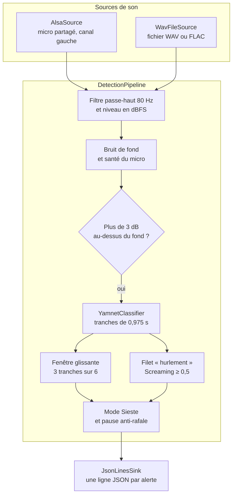
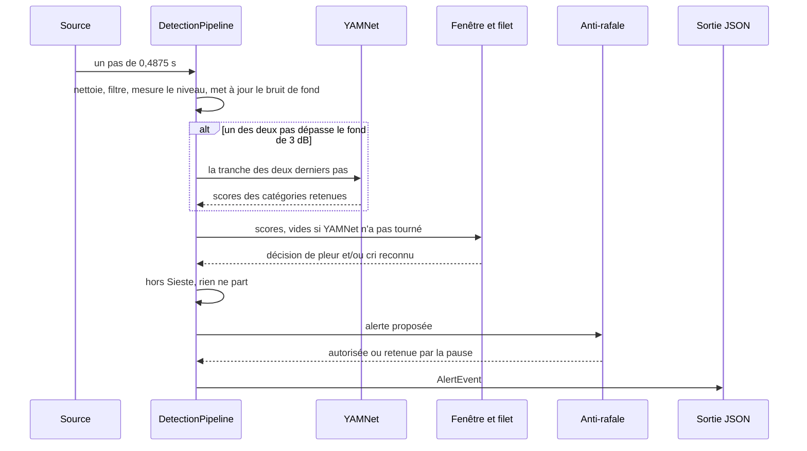

# Fonction : détection des pleurs

Dernière vérification : 2026-11-25 · ec9b5bb

## Résumé

Le module `marmotte.detection` écoute le micro et décide quand prévenir les parents : pleur, gémissement, babillage, rire, ou cri. Il compare le son au bruit de fond de la pièce, ne lance YAMNet que lorsqu'un son dépasse ce bruit de fond, et décide sur plusieurs tranches récentes pour tenir les 8 secondes entre le début d'un pleur et l'alerte. Au lot 2, le service lit un fichier son ou le micro et écrit ses alertes en JSON ; l'envoi des notifications (lot 3) et le vrai mode (lot 4) viendront s'y brancher.

## Contexte

Un pleur manqué est l'erreur la plus grave (D23) : une alerte doit partir au plus 8 s après le début d'un pleur qui dure (D24), sans réveiller les parents pour un bruit de la maison (au plus une fausse alerte par sieste de 2 h, D81). Le tout tourne sur le processeur du Pi 4, à côté du live (6 % d'un cœur pour YAMNet, mesuré au lot 0).

Le module est du Python pur, sans Django : il deviendra le service `marmotte-detection`, séparé de l'app (D82). Le modèle est caché derrière une interface `Classifier`, pour pouvoir passer à un autre modèle (EfficientAT, D62) sans toucher au reste. La spec de référence est la § 8 de `docs/technique/choix-techniques-et-architecture.md` ; les mesures du banc sont dans `docs/plans/resultats-tests-prealables.md`, section « Banc de détection (lot 2) ».

## Architecture



*Le son passe par le niveau et le bruit de fond ; YAMNet ne tourne que si la porte s'ouvre ; deux chemins mènent à une alerte.*

Toutes les données circulent en mono 16 kHz, valeurs flottantes entre -1 et 1. Le son est découpé en **pas** de 7 800 échantillons (0,4875 s) ; une **tranche** de YAMNet couvre deux pas (15 600 échantillons, 0,975 s), et une nouvelle tranche est analysée à chaque pas.

## Flux / Comportement



*Un passage de la boucle par pas de son ; au plus une alerte par pas.*

À chaque pas :

1. **Nettoyage** : une valeur abîmée (NaN, infini) devient 0, tout est ramené entre -1 et 1. Sans cela, une seule valeur NaN rendrait la chaîne sourde pour de bon.
2. **Niveau** : mesuré après un filtre passe-haut à 80 Hz, qui retire les variations de pression lentes du micro (1 à 2 Hz vers -50 dBFS, lot 0) ; YAMNet, lui, reçoit le son brut.
3. **Bruit de fond** : il suit vite la pièce pendant les 10 premières secondes, puis descend vite (constante de 2 s) et monte lentement (0,1 dB/s au plus), pour qu'un long pleur ne s'y fonde pas. Un son est comparé au bruit de fond tel qu'il était avant lui.
4. **Porte** : YAMNet tourne si l'un des deux pas de la tranche dépasse le bruit de fond de 3 dB ; sinon la tranche compte comme vide.
5. **Fenêtre glissante** : une tranche est positive pour une catégorie quand son score atteint le seuil (0,5 en sensibilité moyenne). Une décision tombe dès que 3 des 6 dernières tranches sont positives pour la même catégorie ; en cas d'égalité, l'ordre est pleur, gémissement, babillage, rire.
6. **Filet « hurlement »** : il part dès qu'une tranche a un score « Screaming » d'au moins 0,5, une fois par épisode, quoi que décide la fenêtre. Il ne part plus sur le niveau seul (amendement du 2026-11-25).
7. **Mode** : seule la Sieste envoie des alertes ; en Surveillance silencieuse, ni la fenêtre ni le filet ne préviennent.
8. **Anti-rafale** : après une alerte de pleur, la suivante attend 60 s. Une alerte du filet passe outre cette pause et la relance, mais a sa propre pause de 60 s : un pleur continu donne une notification par pause (F-21).
9. **Alerte** : un `AlertEvent` avec un identifiant unique, la catégorie (`scream` pour le filet), l'heure lue sur l'horloge au moment de la décision, la position dans le flux (`offset_s`) et `via_scream_net`.

Le pipeline tient aussi des statistiques (`stats`) : niveau du dernier pas, bruit de fond, micro muet (plus de 10 s sous -100 dBFS, module débranché) et dernière alerte. Le service les écrit dans le journal toutes les 10 s de son.

## Configuration & Utilisation

Réglages de la chaîne (`DetectionConfig` et constantes, valeurs actuelles) :

| Réglage | Défaut | Effet |
|---|---|---|
| `DetectionConfig.gate_margin_db` | 3,0 dB | Écart au bruit de fond qui fait tourner YAMNet |
| `DetectionConfig.n` | 6 | Tranches récentes regardées par la fenêtre glissante |
| `DetectionConfig.k` | 3 | Tranches positives nécessaires pour décider |
| `DetectionConfig.sensitivity` | `medium` | Choisit le seuil dans `THRESHOLDS` |
| `DetectionConfig.pause_s` | 60 s | Pause anti-rafale, pour les pleurs comme pour le filet |
| `THRESHOLDS` | faible 0,7, moyenne 0,5, forte 0,3 | Score à partir duquel une tranche est positive |
| `YAMNET_NAMES` | pleur : « Baby cry, infant cry » et « Crying, sobbing » ; « Whimper », « Babbling », « Baby laughter », « Screaming » | Catégories YAMNet retenues ; le score d'une catégorie est le plus haut de son groupe |
| `ScreamNet(score_threshold)` | 0,5 | Score « Screaming » qui déclenche le filet |
| `HighPass(cutoff_hz, order)` | 80 Hz, ordre 2 | Filtre avant la mesure du niveau |
| `NoiseFloor(warmup_s, rise_db_per_s, fall_tau_s)` | 10 s, 0,1 dB/s, 2 s | Mise en route, montée et descente du bruit de fond |
| `MicHealth(silent_db, silent_after_s)` | -100 dBFS, 10 s | Seuil et durée du micro muet |

Le service en ligne de commande, dans `backend/` :

| Option | Défaut | Effet |
|---|---|---|
| `--wav PATH` ou `--alsa DEVICE` | obligatoire, l'un ou l'autre | Fichier son à lire, ou périphérique ALSA à écouter (`micro` sur le Pi) |
| `--loop` | non | Relit le fichier en boucle |
| `--sensitivity` | `medium` | `low`, `medium` ou `high` |
| `--models-dir PATH` | `backend/models` | Dossier de `models.toml` et du modèle |

Le mode est fixé à Sieste jusqu'au lot 4. Au premier lancement, le modèle YAMNet (environ 4 Mo, Apache 2.0) est téléchargé depuis l'adresse de `backend/models/models.toml`, dans un fichier `.part` vérifié par son empreinte SHA-256 avant d'être renommé ; un modèle déjà présent est vérifié à chaque démarrage, et refusé s'il a changé. Le fichier `backend/models/yamnet.tflite` est ignoré par Git, et `just deploy` ne l'écrase pas sur le Pi.

Exemple réel, sur un fichier de 10 s de silence suivies de 9 s de pleurs :

```bash
cd backend
uv run python -m marmotte.detection --wav sieste.flac
```

```json
{"id": "09adca2a-5ab5-40de-8b2c-60fb446f7b2c", "kind": "cry", "at": "2026-11-25T16:52:22.852403+00:00", "offset_s": 11.7, "via_scream_net": false}
```

Le journal (sortie d'erreur) donne toutes les 10 s : `level -45.0 dBFS, floor -54.2 dBFS, mic silent: False, last alert: None`. Sur le Pi : `uv run python -m marmotte.detection --alsa micro` (non rejoué ici, il faut `libportaudio2`).

### Banc d'essai

Le banc (`backend/bench/`) contient 127 sons Freesound sous licence CC0 ou CC BY, convertis en FLAC mono 16 kHz, listés dans `manifest.toml` avec leur catégorie et, pour les pleurs, les segments de chaque épisode ; `CREDITS.md` les crédite avec un lien vers leur licence.

```bash
cd backend
uv run python -m marmotte.detection.bench run            # rapport, code de sortie 1 si le garde-fou échoue
uv run python -m marmotte.detection.bench run --local    # ajoute backend/bench/local/manifest.toml, ignoré par Git
uv run python -m marmotte.detection.bench prepare telechargement.mp3 --label cry \
    --source https://freesound.org/s/12345/ --author quelqu_un --license CC0-1.0 \
    --segments "0.5:14.2" --title "Titre du son"
```

`prepare` refuse toute licence autre que CC0 1.0, CC BY 3.0 ou CC BY 4.0, convertit le son, puis l'ajoute au manifeste et aux crédits. Le banc local sert aux enregistrements non libres (vidéos, enregistrements du bébé) : sa licence n'est pas contrôlée, et il reste hors de Git.

`run` rejoue chaque son de bébé entre 15 s de pièce calme et 5 s de fin, sans pause anti-rafale, puis 6 h de bruits de fond enchaînés dans un ordre et à un gain (±6 dB) tirés au sort (graine 42). Un pleur long (plus de 8 s) est signalé si une alerte part dans les 8 s qui suivent son début. Le rapport donne les pleurs longs manqués, les fausses alertes par 2 h, la part de sons signalés par catégorie, l'objectif D81 (« met » ou « NOT met ») et le garde-fou de la CI.

**Garde-fou de la CI** (P67) : la fusion est refusée si un pleur long est manqué, ou si les fausses alertes dépassent `MAX_FALSE_ALERTS_PER_2H` (1,34 par 2 h, soit le niveau mesuré au réglage du lot 2). Le job `detection` de `.github/workflows/ci.yml` lance `pytest -m "model or bench"` sur x86 et ARM quand la détection, le banc, le modèle, les dépendances ou les réglages de Python changent ; le modèle est gardé en cache selon l'empreinte de `models.toml`.

## Points d'attention

- **L'objectif D81 n'est pas encore tenu** : 4 fausses alertes en 6 h de fonds, soit 1,33 par 2 h, toutes dues à une porte qui grince que YAMNet note 0,96 « pleur de bébé ». Aucun réglage essayé ne tient à la fois 0 pleur manqué et 1 fausse alerte par 2 h ; la piste est EfficientAT. Le seuil de 0,5 tombe pile sur un des niveaux de score de YAMNet, et la marge du garde-fou est nulle.
- **Les sensibilités faible et forte ne sont pas réglées** : en faible, 4 pleurs longs sur 32 sont manqués ; en forte, 2,66 fausses alertes par 2 h. À revoir avant de proposer la sensibilité dans l'app.
- **Le filet ne rattrape plus un cri que YAMNet ne reconnaît pas** (2 cris sur 8 du banc : un bébé de 4 mois pris pour un chien, un enfant excité qui court).
- **Un pleur court peut passer** : `cry-393769` (6 s) ne donne aucune alerte ; seuls les pleurs de plus de 8 s sont garantis.
- **Un son continu peu au-dessus du bruit de fond s'y fond** : 6 dB au-dessus d'une musique, le modèle cesse de tourner après environ 30 s, d'où une seule alerte sur 2 minutes. Les vrais pleurs, entrecoupés de respirations, devraient l'éviter ; à vérifier avec des enregistrements réels.
- **Mesures faites sur PC (x86)** ; le job ARM de la CI dira si le modèle se comporte pareil sur l'architecture du Pi.
- **Le micro demande PortAudio** : `sounddevice` n'est importé qu'à l'ouverture d'`AlsaSource`, pour que le reste tourne sans `libportaudio2` (CI, PC). Si le périphérique ALSA se bloque, la lecture attend sans fin et la santé du micro ne bouge plus ; la surveillance des services viendra plus tard.
- **Les alertes ne partent pas encore** : elles sont seulement écrites en JSON (file d'envoi au lot 3).

## Tests & Vérification

```bash
cd backend
uv run pytest marmotte/detection/tests -m "not hardware and not model and not bench"   # comme la CI de base, environ 50 s
uv run pytest -m "model or bench"                                                     # vrai YAMNet et banc complet, environ 2 min 20 sur PC
uv run pytest marmotte/detection/tests/test_audio.py -m hardware                      # sur le Pi seulement (non rejoué ici)
```

Les tests de la chaîne utilisent de faux classifieurs (`marmotte/detection/tests/fakes.py`) : on vérifie la décision sans le modèle. Les tests marqués `model` font tourner le vrai YAMNet (classification de l'extrait de pleur, porte qui claque, fête dès le démarrage, ligne de commande) ; `bench` rejoue le banc complet.

Recette à la main : créer un fichier de 10 s de silence suivies d'un pleur, le passer à `python -m marmotte.detection --wav` et vérifier qu'une ligne `"kind": "cry"` sort, avec un `offset_s` dans les 8 s qui suivent le début du pleur.

## Fichiers clés

| Chemin | Rôle |
|---|---|
| `backend/marmotte/common/enums.py` | `Mode`, `SoundClass`, `Sensitivity`, partagés par les services |
| `backend/marmotte/detection/types.py` | Formats : 16 kHz, pas, tranche, `AlertEvent` |
| `backend/marmotte/detection/audio.py` | Sources : tableau, fichier son, micro ALSA ; conversion en mono 16 kHz |
| `backend/marmotte/detection/level.py` | Filtre passe-haut, niveau, bruit de fond, santé du micro |
| `backend/marmotte/detection/classifier.py` | Interface `Classifier`, `YamnetClassifier`, catégories retenues |
| `backend/marmotte/detection/model_files.py` | Téléchargement et vérification du modèle |
| `backend/marmotte/detection/decision.py` | Seuils, fenêtre glissante, filet, anti-rafale |
| `backend/marmotte/detection/pipeline.py` | `DetectionConfig`, `DetectionPipeline`, statistiques |
| `backend/marmotte/detection/service.py`, `sinks.py`, `__main__.py` | Boucle du service, sortie JSON, ligne de commande |
| `backend/marmotte/detection/bench/` | Manifeste, préparation des sons, rejeu et garde-fou du banc |
| `backend/bench/` | Sons du banc, `manifest.toml`, `CREDITS.md` |
| `backend/models/models.toml` | Adresse, empreinte et licence du modèle |
| `.github/workflows/ci.yml` | Job `detection` (banc sur x86 et ARM) |

## Références

- Issue #4 (lot 2) et son plan : `docs/plans/2026-11-19-lot-2-detection.md`.
- Décisions et propositions : D23, D24, D25, D62, D81, D82, P10, P11, P12, P13, P16, P17, P67, P73.
- Voir aussi : `docs/technique/choix-techniques-et-architecture.md` (§ 8), `docs/fonctionnel/specs-fonctionnelles.md` (F-20, F-21), `docs/plans/resultats-tests-prealables.md` (« Banc de détection (lot 2) »), `backend/bench/CREDITS.md`.
