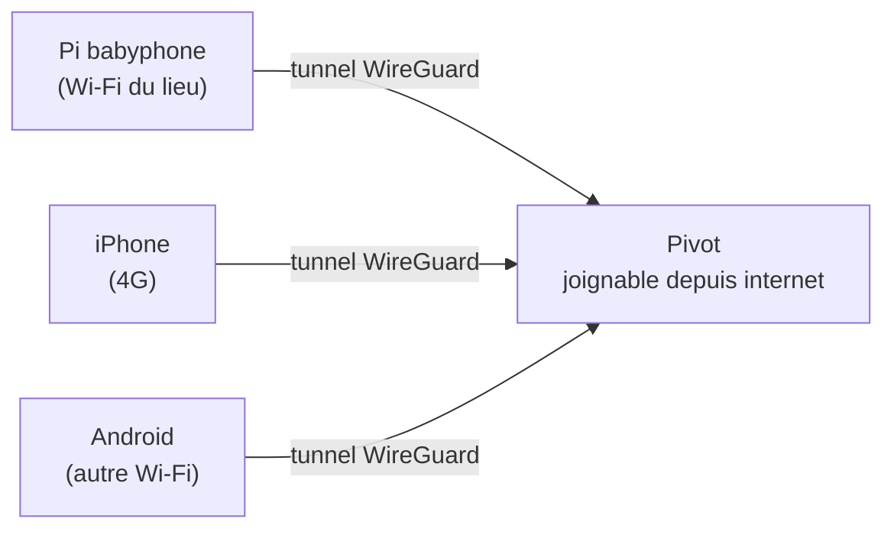

# Piste : tunnel chiffré WireGuard

> **Statut : évolution V2 à étudier sérieusement** (décision du 2026-11-18 ; mise de côté le 2026-11-17). En V1, le live n'est visible que depuis le même réseau que le babyphone. En V2, cette piste permettrait de voir le live à distance, par exemple depuis un téléphone en 4G. Les choix de la V1 ne doivent pas la bloquer.

## Le besoin auquel elle répond

Le babyphone se déplace : maison, amis, famille, salle des fêtes. Le téléphone et le Pi ne sont donc pas toujours sur le même réseau. Un téléphone en 4G, ou dans une autre pièce sur un autre Wi-Fi, ne voit pas le Pi : celui-ci est caché derrière la box du lieu (NAT) et n'est pas joignable depuis internet.

Un tunnel chiffré relie les téléphones et le Pi comme s'ils étaient sur un même réseau privé, quel que soit le réseau sur lequel chacun se trouve.

## WireGuard en bref

- VPN moderne, intégré au noyau Linux depuis la version 5.6, avec des applications officielles pour iOS et Android.
- Chaque appareil (un « pair ») a une paire de clés, privée et publique, comme pour SSH. On déclare dans la configuration les clés publiques des pairs autorisés : aucun mot de passe, aucun compte.
- Cryptographie moderne et fixe (Curve25519, ChaCha20-Poly1305, BLAKE2s), sans options à mal configurer.
- Passe en UDP (port 51820 par défaut). Le tunnel est silencieux : un appareil sans la bonne clé ne reçoit aucune réponse.
- Chaque pair a une adresse fixe dans le tunnel (ex. `10.8.0.2` pour le Pi), **quel que soit le réseau du lieu**.

Exemple de configuration côté Pi :

```ini
[Interface]
PrivateKey = <clé privée du Pi>
Address = 10.8.0.2/24

[Peer]                      # le serveur pivot
PublicKey = <clé publique du pivot>
Endpoint = maison.exemple.fr:51820
AllowedIPs = 10.8.0.0/24
PersistentKeepalive = 25    # garde le passage ouvert à travers la box du lieu
```

## La difficulté : deux appareils derrière un NAT

Le Pi (derrière la box d'un ami, ou derrière le partage de connexion d'un téléphone) et le téléphone en 4G sont tous deux derrière un NAT. Aucun des deux ne peut joindre l'autre directement. Il faut un **pivot** joignable depuis internet, auquel les deux se connectent.



## Trois façons d'avoir un pivot

| | Pivot à la maison | Petit serveur loué (VPS) | Tailscale (WireGuard géré) |
|---|---|---|---|
| Principe | La box de la maison redirige le port UDP 51820 vers un appareil allumé en permanence, par exemple le **Pi 3B+ de réserve** | Un serveur loué fait office de pivot | Un service gère les clés et la traversée de NAT ; les appareils se connectent souvent en direct |
| Coût | Gratuit (matériel déjà là) | ~3-5 €/mois | Gratuit pour un usage personnel |
| Tiers | Aucun | L'hébergeur (il ne voit que du trafic chiffré si le flux l'est aussi, cf. ci-dessous) | Le serveur de coordination de Tailscale (voit les appareils, pas le contenu) ; compte Google, Apple ou GitHub requis |
| Prérequis | Une IPv4 publique à la maison (certains FAI la partagent entre abonnés et ne la donnent que sur demande) ; un nom de domaine dynamique si l'IP change | Administrer un serveur exposé à internet | Aucun |
| Points faibles | Si la connexion de la maison tombe, plus de live à distance ; le flux remonte par le débit montant de la maison | Coût récurrent, contraire à l'objectif d'économie | Contraire à la règle « pas de service tiers » ; alternative auto-hébergée (Headscale) qui ramène au besoin d'un pivot |

Avec un pivot à la maison ou un VPS, le pivot déchiffre le tunnel avant de rechiffrer vers l'autre pair. Si le flux vidéo est lui-même chiffré de bout en bout (c'est le cas de WebRTC, avec DTLS-SRTP), le pivot ne voit jamais l'image ni le son.

## Ce que le tunnel apporterait en plus

- **Une adresse stable pour le Pi** (`10.8.0.2` partout), utile pour le HTTPS et la PWA dont l'adresse ne doit pas changer d'un lieu à l'autre.
- **Contrôle d'accès fort** : seuls les téléphones dont la clé est déclarée atteignent le Pi. Un invité sur le même Wi-Fi ne le voit pas.

## Ce que le tunnel ne change pas

- Les notifications passent toujours par les serveurs d'Apple et de Google.
- Le Pi a toujours besoin d'internet sur le lieu (Wi-Fi ou partage de connexion d'un téléphone).

## Côté téléphones

- Installer l'application officielle WireGuard (iOS, Android) et importer la configuration, par exemple en scannant un QR code.
- iOS et Android savent activer le tunnel automatiquement selon le réseau (activation « à la demande »). L'impact sur la batterie est faible : WireGuard est silencieux quand il ne transporte rien.

## Si on la ressort

1. Choisir le pivot. Le pivot à la maison avec le Pi 3B+ est le plus cohérent avec les objectifs (gratuit, sans tiers).
2. Vérifier que la box de la maison a une IPv4 publique, sinon passer par l'IPv6.
3. Générer les clés : une paire par appareil (pivot, Pi, iPhone, Android).
4. Tester depuis la 4G avant de s'en servir pour une vraie sieste.

## Références

- Site officiel : <https://www.wireguard.com/>
- Démarrage rapide : <https://www.wireguard.com/quickstart/>
- Headscale (serveur de coordination auto-hébergé) : <https://github.com/juanfont/headscale>
