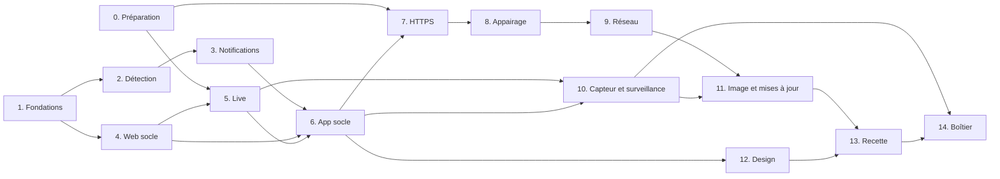

# Marmotte V1 : plan directeur de construction

> **For agentic workers:** ce document découpe la V1 en lots. Chaque lot a son propre plan détaillé dans `docs/plans/`, à exécuter avec superpowers:subagent-driven-development (recommandé) ou superpowers:executing-plans. Les étapes utilisent des cases à cocher (`- [ ]`).

**Goal:** livrer la V1 complète de Marmotte, dans un délai court (D80).

**Architecture:** services séparés sur un Raspberry Pi 4 : go2rtc (live WebRTC), `marmotte-detection` (micro → YAMNet → alerte), `marmotte-notifications` (Web Push, file d'envoi), `marmotte-web` (Django + django-ninja : app, API, SSE, appairage, réseau, surveillance). App PWA React. Système en image A/B (Mender, mode autonome).

**Tech Stack:** Python 3.14, uv, Django 6, django-ninja, SQLite (WAL), ai-edge-litert + YAMNet, pywebpush, go2rtc, rpicam-vid, ALSA `dsnoop`, NetworkManager, certbot + certbot-dns-infomaniak, mender-convert ; React 19, TypeScript, Vite, React Three Fiber ; GitHub Actions.

**Spec:** `docs/technique/choix-techniques-et-architecture.md` (specs techniques, validée D85), `docs/fonctionnel/specs-fonctionnelles.md`, `docs/technique/modelisation-3d.md`. Décisions : `docs/brainstorming/notes-brainstorming.md`.

## Global Constraints

Valables pour tous les lots :

- Python **3.14** (D94 : dernière version compatible avec toutes les bibliothèques, LiteRT compris), **installé par uv** (Trixie fournit 3.13) ; code **typé**, vérifié par **pyright** dans l'intégration continue ; style **ruff** (D58, P65).
- **Django 6** + **django-ninja**, servi en **ASGI** par **Uvicorn** ; **SQLite** en mode **WAL** dans la partie données (D63, D64).
- Raspberry Pi OS **Lite 64 bits** (Debian 13 « Trixie ») ; **aucun `apt upgrade` sur le Pi en usage** (D71).
- **Aucune dépendance sous licence non commerciale** ; du code **GPL** seulement comme **programme séparé**, jamais intégré (§ 6.12 des notes).
- **Aucun secret dans le dépôt** (clés VAPID, jeton d'API Infomaniak, mots de passe, clés d'appareil, clé de signature) (§ 6.12).
- **L'image et le son du bébé ne sortent jamais du réseau local** ; aucun enregistrement (D6, D9).
- **Code, identifiants et messages de commit en anglais** ; **interface et documentation en français** (D51, D52).
- Commits au format **Conventional Commits** : `type(module): description`, types `feat`, `fix`, `refactor`, `test`, `docs`, `chore`, `ci` (arbitrage de Claude, inscrit dans le `CLAUDE.md` du lot 1). Branches `type/<numéro d'issue>-<slug>`, fusion par squash (P71).
- Matériel simulé sur PC derrière des interfaces Python (P63) ; tests matériels marqués `hardware`, exécutés seulement sur le Pi.
- **Règle d'arrêt** : un test préalable qui échoue malgré les parades documentées et remet en cause un choix T1 à T12 → arrêt et retour vers l'auteur (§ 20.1 des specs techniques).

## Review Focus

Les cinq situations que la spec implique sans qu'aucun lot ne les teste naturellement, à couvrir dans le lot indiqué :

1. **Le micro rend du silence parfait** (module débranché, overlay cassé) : la détection doit signaler « micro muet », pas seulement « aucun pleur ». Lot 2 (indicateur), lot 10 (alerte).
2. **L'heure du Pi est fausse au démarrage** (pas encore synchronisée) : le HTTPS, le certificat et les notifications ne doivent pas échouer en silence ; l'état affiché doit le dire. Lots 7 et 10.
3. **Trois services écrivent dans SQLite en même temps** (web, détection, notifications) : aucune erreur « database is locked » visible ; délai d'attente (`busy_timeout`) configuré. Lots 3 et 4.
4. **L'IP du Pi change en pleine sieste** (renouvellement DHCP) : le nom du babyphone suit, le live se reconnecte. Lot 7.
5. **Coupure de courant pendant une mise à jour** : au redémarrage, le Pi revient sur la copie intacte. Lot 11.

---

## 1. Les lots

| Lot | Contenu | Livrable testable | Exigences couvertes | Dépend de |
|---|---|---|---|---|
| **0. Préparation et tests préalables** | Achats ; Pi de développement ; test « DNS rebinding » ; endurance de go2rtc ; micro et `dsnoop` ; charge de YAMNet ; démarrage de l'image Mender avec la caméra | Rapport `docs/plans/resultats-tests-prealables.md` | Conditions de T2, T3, T4, T6, T9 ; NF-05 | — |
| **1. Fondations du dépôt** | Dépôt Git et GitHub ; licences ; `CLAUDE.md` Marmotte ; projet Python (uv, Django, ninja) ; projet front (Vite, React, TS) ; ruff, pyright, pytest, ESLint, Prettier, Vitest ; pre-commit ; GitHub Actions (x86 et ARM) ; commande de déploiement sur le Pi de dev | `GET /api/health` testé ; CI verte | P65, P66, P69 à P72 | — |
| **2. Détection des pleurs** | Sources audio (fichier, ALSA) ; volume et bruit de fond ; YAMNet ; fenêtre glissante ; filet « hurlement » ; anti-rafale ; sensibilité ; pipeline ; service ; banc d'essai et ses seuils en CI | Le banc tient les objectifs de D81 ; `python -m marmotte.detection` émet des alertes depuis un fichier | F-17 à F-23 ; NF-04 ; D62, D81 | 1 |
| **3. Notifications** | Bibliothèque d'envoi (pywebpush, VAPID) ; file d'envoi ; service `marmotte-notifications` ; filet de la détection ; abonnements invalides ; destinataires | Une alerte du banc arrive sur un téléphone de test, service coupé compris | F-24, F-26, F-32 à F-37 ; P73 | 1, 2 |
| **4. Service web socle** | Modèles Django partagés ; API (état, modes, réglages, destinataires) ; SSE ; machine à états des modes ; Uvicorn | Les modes et le compte à rebours fonctionnent en simulation ; SSE testé | F-11 à F-16 ; P36 | 1 |
| **5. Live** | Configuration go2rtc (`rpicam-vid`, son du micro partagé, `preload`) ; relais de la négociation WebRTC ; caméra simulée sur PC ; caméra à la demande ; début du script de préparation du système | Live < 1 s sur les deux téléphones, depuis le Pi | F-27, F-28, F-31 ; D59 à D61 | 0, 4 |
| **6. App socle** | PWA (manifeste, service worker) ; client typé OpenAPI ; écrans état, live (zoom), modes, destinataires ; notifications et ouverture du live ; écran hors réseau | L'app installée reçoit une alerte et ouvre le live | F-04, F-07, F-25, F-29, F-30 ; P56, P57 | 3, 4, 5 |
| **7. Nom et HTTPS** | Mise à jour du nom par l'API Infomaniak (déclencheur NetworkManager) ; certbot + `certbot-dns-infomaniak` ; service HTTPS ; heure (NTP) | L'app s'ouvre en `https://bebe.<domaine>.fr` sur deux réseaux | D65, D66, D93 | 0, 6 |
| **8. Appairage et sécurité** | Clé d'appareil (cookie) ; protection de l'API, du SSE et du relais ; code initial ; invitations ; retrait ; limites ; bouton de réinitialisation | Un téléphone non appairé n'obtient rien ; parcours complet d'appairage | F-05, F-06, F-08 à F-10, F-27, F-47 ; D67, D68 | 4, 6, 7 |
| **9. Réseau autonome** | Pilotage de NetworkManager ; réseaux ajoutés depuis l'app ; réseau de configuration au démarrage ; portail captif ; DNS local (P50) | Installation dans un lieu inconnu sans écran | F-02, F-03, F-46, F-48 à F-51 ; D69, D70 | 4, 7, 8 |
| **10. Capteur et surveillance** | SHT31-D (et simulé) ; mesures, couleurs, correction ; surveillance de go2rtc, de la détection, des notifications ; relance et notifications d'information ; état complet | Chaque panne provoquée est relancée et notifiée | F-38 à F-45 ; D26 | 3, 4, 5, 6 |
| **11. Système, image et mises à jour** | Script de préparation complet (P64) ; services systemd et droits ; image A/B (mender-convert) en CI ; signature ; mise à jour à la demande, vérification, retour arrière, sauvegarde de la base ; reconstruction mensuelle ; outil de préparation du boîtier et étiquette | Mise à jour réussie, puis mise à jour défectueuse annulée toute seule | F-01, F-16, F-52 à F-55 ; D71, D72, P52 à P55 | 0 à 10 |
| **12. Design de l'app** | Trois prototypes (3D animée R3F, glassmorphisme, neumorphisme) ; choix de l'auteur ; design final ; pause 3D pendant le live | Design retenu appliqué à tous les écrans | D73 à D75 ; NF-09 ; P58, P59 | 6 |
| **13. Recette et guides** | Liste de recette P68 ; capture du trafic sortant ; guides d'installation et d'utilisation (passage par Safari, exceptions Ne pas déranger, câbles loin du lit, limites connues) | Recette signée sur le vrai matériel | NF-01 à NF-11 ; F-04, F-45 | 1 à 12 |
| **14. Boîtier** | Mesures ; boîtier rectangulaire (Fusion 360 ou FreeCAD, ABS) ; coque marmotte (Blender) ; tests thermique, micro, capteur ; export glTF | Babyphone dans son boîtier, testé une heure en charge | Specs 3D ; P58, P61, P62 | 5, 10 |

---

## 2. Calendrier indicatif

Le délai de la V1 est serré (§ 18.1 des specs techniques). Le calendrier suit l'ordre « socle, autonomie, confort » : si le temps manque, ce sont les derniers lots qui glissent. Les lots 0 (matériel, téléphones) et 14 (impression) demandent les mains de l'auteur ; les autres peuvent avancer en parallèle.

| Semaine | Lots |
|---|---|
| 1 | **0** (achats, Pi, test DNS, endurance go2rtc) ; **1** |
| 2 | **2** ; lot 0 suite (micro et charge de YAMNet à réception du micro) |
| 3 | **3**, **4** |
| 4 | **5**, **6** |
| 5 | **7**, **8** |
| 6 | **9**, **10** (avec de la marge) |
| 7 | **11** |
| 8 | **12**, **13** ; boîtier rectangulaire d'essai (lot 14) |
| 9 | **14** (coque marmotte), marge |

---

## 3. Plans détaillés

| Lot | Plan | État |
|---|---|---|
| 0 | `docs/plans/2026-11-19-lot-0-preparation.md` | Écrit |
| 1 | `docs/plans/2026-11-19-lot-1-fondations.md` | Écrit |
| 2 | `docs/plans/2026-11-19-lot-2-detection.md` | Écrit |
| 3 | `docs/plans/2026-11-26-lot-3-notifications.md` (design : `docs/plans/2026-11-26-lot-3-notifications-design.md`) | Écrit |
| 4 à 14 | À écrire au démarrage de chaque lot, en tenant compte des résultats du lot 0 | — |

---

## 4. Couverture des exigences

| Exigences | Lots |
|---|---|
| F-01 | 11 |
| F-02, F-03, F-46, F-48 à F-51 | 9 |
| F-04 | 6, 13 (guide) |
| F-05, F-06, F-08 à F-10, F-47 | 8 |
| F-07, F-25, F-29, F-30 | 6 |
| F-11 à F-15 | 4 |
| F-16, F-52 à F-55 | 11 |
| F-17 à F-23 | 2 |
| F-24, F-26, F-32 à F-37 | 3 (envoi), 4 (API), 6 (écrans) |
| F-27 | 5, 8 |
| F-28, F-31 | 5 |
| F-38 à F-45 | 10 (et 6 pour l'affichage) |
| NF-01, NF-02 | 13 (capture du trafic), tous |
| NF-03 | 2, 5, 13 |
| NF-04 | 2 |
| NF-05 | 0, 13 |
| NF-06, NF-07, NF-10 | 13 |
| NF-08 | tous les écrans |
| NF-09 | 12 |
| NF-11 | 13 (guide), 14 |
