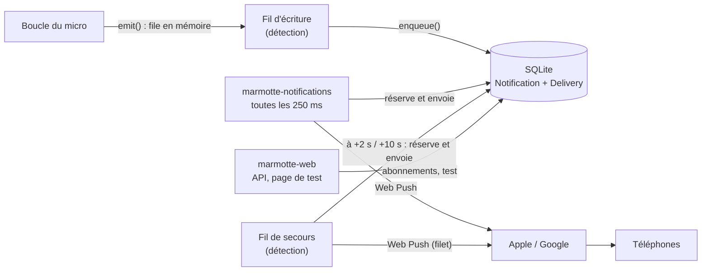

# Lot 3 : notifications — design

> **Statut** : validé par l'auteur le 2026-11-26. Plan d'exécution : `docs/plans/2026-11-26-lot-3-notifications.md`. Issue : #5.

## Intention

Construire l'envoi des notifications Web Push du babyphone : la bibliothèque d'envoi, la file d'envoi en base, le service `marmotte-notifications`, le filet de la détection, les destinataires et les abonnements devenus invalides. Le but est qu'**un pleur ne soit jamais perdu** à cause d'un composant en panne (F-26, P73, D23). Livrable : une alerte du banc arrive sur un téléphone de test, même avec le service de notifications arrêté.

## Objectifs, non-objectifs, anti-objectifs

- **Objectifs** :
  - une alerte décidée par la détection est écrite en base, puis envoyée à chaque destinataire en priorité haute (F-24, F-26) ;
  - le service arrêté, la détection envoie elle-même l'alerte au bout d'environ 2 s ; le service figé en plein envoi, elle la reprend au bout d'environ 10 s (P73 amendé) ;
  - un abonnement refusé par Apple ou Google est marqué invalide et les autres destinataires sont prévenus (F-37) ;
  - un téléphone retiré des destinataires reçoit un dernier message (F-35) ; les informations suivent les mêmes destinataires que les alertes (F-36) ;
  - la base SQLite est partagée sans erreur « database is locked » par plusieurs processus (point 3 à surveiller du plan directeur) ;
  - une alerte du banc arrive sur l'iPhone de l'auteur et sur Google Chrome (PC), service arrêté compris.
- **Non-objectifs** (autres lots) :
  - API des destinataires et ses règles : « au moins un en Sieste » (F-32), « Je prends les alertes » (F-33), gestion croisée (F-34) : lot 4 ;
  - affichage dans l'app, grosse alerte sans destinataire valide, vrai service worker de la PWA, ouverture du live (F-25) : lot 6 ;
  - protection de l'API par la clé d'appareil : lot 8 ;
  - renouvellement automatique du certificat, mise à jour du nom : lot 7 ;
  - services systemd et chien de garde : lot 11 ;
  - notifications d'information des autres lots (modes, pannes, mises à jour) : chaque lot ajoute ses types ;
  - canal des événements en direct (niveau du micro, signes de vie) : lot 4.
- **Anti-objectifs** :
  - la boucle de lecture du micro attend la base ou le réseau (le son déborderait) ;
  - une alerte affichée en double sur l'iPhone dans un cas courant (réseau lent) ;
  - un secret ou le nom de domaine réel dans le dépôt ;
  - le Pi envoie des requêtes vers une adresse fournie par n'importe qui sur le réseau local (abonnement vers un hôte arbitraire).

## Contraintes

- Python 3.14, Django 6, django-ninja, SQLite, pyright `standard`, ruff (règles de `CLAUDE.md`), un fichier par objet dans chaque dossier.
- Licences permissives seulement : pywebpush (MPL 2.0, non modifiée), py-vapid (MPL 2.0), http-ece (MIT), cryptography, requests, aiohttp (Apache 2.0 ou BSD).
- Aucun secret dans le dépôt : clé VAPID générée sur la machine, dans `DATA_DIR` ; jeton d'Infomaniak hors dépôt.
- Matériel et services extérieurs derrière une interface, avec une doublure pour les tests (P63).
- L'heure du Pi peut faire un saut en avant au démarrage (synchronisation NTP) : les délais critiques ne doivent pas en souffrir gravement.

## Approches

Commun à toutes : chaque notification est écrite en base avant l'envoi ; l'envoi à chaque téléphone est **réservé** par une seule requête SQL (un seul envoyeur gagne) ; la détection garde un filet.

Ce qui distingue les approches : **comment le service apprend qu'une alerte attend.**

| | Principe | Pour | Contre |
|---|---|---|---|
| **A. Relecture de la base toutes les 250 ms** (retenue) | Le service interroge la file à intervalle fixe | Aucun canal, rien à configurer ; une lecture SQLite sans changement reste en mémoire | Jusqu'à 250 ms de réaction, négligeable devant les ~8 s de la détection et la livraison par Apple ou Google |
| B. Signal par socket Unix + relecture lente de secours | La détection fait signe au service, qui relit aussi la base chaque seconde | Réaction immédiate | Fichier de socket, droits sous systemd, service absent à gérer : plus de code pour 250 ms au plus |

Écartées :
- **Redis ou un autre courtier de messages** (D95) : il ne remplacerait pas SQLite (sa publication perd un message quand personne n'écoute, justement quand le service est en panne), ajouterait un point de panne sur le chemin du pleur (contraire à D82) et n'est plus sous licence libre depuis la 7.4.
- **La détection envoie toujours elle-même ses alertes** et le service ne fait que le reste : il faudrait un filet dans l'autre sens, donc la même complexité, et P73 serait remise en cause.

**Choix de l'auteur : A.** Le canal des événements en direct, qui ne peut pas passer par la base (usure de la carte SD), se concevra au lot 4 ; le service de notifications pourra l'écouter s'il le faut.

## Décisions de l'auteur (2026-11-26)

Consignées dans le journal privé des décisions :

- **D95** : SQLite pour tous les services, réglé pour plusieurs processus ; pas de Redis ; approche A.
- **D96** : pywebpush, malgré son mainteneur unique, isolée derrière l'interface `PushSender`.
- **D97** : l'iPhone est testé dès ce lot : le certificat Let's Encrypt du nom `sentinelle` est avancé du lot 7. Pas d'Android de test pour l'instant : le chemin de Google se teste avec Google Chrome sur le PC.
- **D98** : format **déclaratif** des notifications ; durée de garde chez Apple et Google de **10 min** pour une alerte et **24 h** pour une information ; historique gardé **7 jours** sur le Pi.
- **P73 amendé** : reprise par la détection à ~2 s d'une livraison non réservée, à ~10 s d'une livraison réservée par le service et pas terminée.
- **D99, dernier recours** (réponse à la relecture) : si la base refuse l'écriture d'une alerte, la détection l'envoie depuis une copie en mémoire des abonnements, dans un module à part, documenté (section « Dernier recours »).
- **D88 complété** : textes du tableau « Textes » ci-dessous.
- Le lot est codé par Claude (exécution comme les lots 1 et 2).

## Vue d'ensemble



## Base de données

Nouveau fichier `marmotte/settings/django/databases.py`, rassemblé par `base.py` :

```python
DATABASES = {
    "default": {
        "ENGINE": "django.db.backends.sqlite3",
        "NAME": DATA_DIR / "marmotte.sqlite3",
        "OPTIONS": {
            "transaction_mode": "IMMEDIATE",  # wait for the lock (timeout) instead of failing on a read-to-write upgrade
            "timeout": 5,  # seconds of waiting before "database is locked"
            "init_command": "PRAGMA journal_mode=WAL; PRAGMA synchronous=NORMAL;",
        },
    }
}
```

- Source des options : doc Django, section « Database is locked errors » et « Setting pragma options » (`docs.djangoproject.com/en/6.0/ref/databases/`).
- `DATA_DIR` est créé s'il n'existe pas, avant la première connexion.
- Les trois programmes (web, détection, notifications) passent par l'**ORM de Django** : `prepare_environment()` puis `django.setup()`.
- Transactions courtes : jamais d'appel réseau dans une transaction.
- `just deploy` applique les migrations sur le Pi de dev (`manage.py migrate`) ; le moment des migrations dans l'image reste au lot 11.
- La règle `.claude/rules/migrations.md` passe de « à partir du lot 4 » à « à partir du lot 3 ».
- Pas de `django.contrib` (ni admin, ni auth) : les `admin.py` attendent un lot qui en a besoin.

## Modules et modèles

Deux nouvelles applications Django, déclarées dans `LOCAL_APPS`.

**`marmotte/phones/`** (le lot 8 y ajoutera l'appairage)

| `Phone` | |
|---|---|
| `name` | texte court (« iPhone ») |
| `receives_alerts` | booléen, vrai par défaut (destinataires par défaut : les téléphones appairés, § 12 des specs fonctionnelles) |
| `created_at` | horodatage |

**`marmotte/notifications/`**

| `PushSubscription` | |
|---|---|
| `phone` | un-pour-un vers `Phone` (un téléphone, une app installée, un abonnement) |
| `endpoint` | adresse d'envoi, unique |
| `p256dh`, `auth` | clés de chiffrement fournies par le navigateur |
| `created_at`, `updated_at` | |
| `invalid_at` | vide tant que l'abonnement est valide |
| `invalid_reason` | texte (code HTTP et message reçus) |

| `Notification` | |
|---|---|
| `id` | UUID, clé primaire ; pour une alerte, l'`id` de l'`AlertEvent` (P73) |
| `kind` | `NotificationKind` (ci-dessous) |
| `title`, `body` | texte calculé à la mise en file |
| `navigate_path` | chemin ouvert quand on touche la notification (`/live`, `/`, `/push-test/`) |
| `urgency` | `high` ou `normal` |
| `ttl_s` | durée de garde chez Apple ou Google |
| `event_at` | heure de l'événement (celle du texte) |
| `created_at` | heure de la mise en file ; l'échéance vaut `created_at + ttl_s` |

| `Delivery` (un envoi à un abonnement) | |
|---|---|
| `notification`, `subscription` | clés étrangères ; unique ensemble |
| `status` | `pending`, `sending`, `sent`, `gone`, `failed`, `expired` |
| `claimed_by` | `service` ou `detection` (vide sinon) |
| `claimed_at` | heure de la réservation |
| `attempts` | nombre de tentatives |
| `next_attempt_at` | heure à partir de laquelle la livraison peut être tentée |
| `last_http_status`, `last_error` | dernier résultat |
| `sent_at`, `sent_by` | envoi réussi |

Index sur (`status`, `next_attempt_at`).

`NotificationKind` (énumération dans `marmotte/common/enums.py`, partagée par la détection et les notifications) : `cry`, `whimper`, `babble`, `laugh`, `scream` (alertes, mêmes valeurs que `SoundClass`) ; `recipient_removed`, `subscription_invalid`, `test` (informations).

## Textes (D88)

Heure au format `HH:MM`, fuseau `Europe/Paris` (`TIME_ZONE`). Textes écrits par le Pi, puisque l'iPhone affiche le message déclaratif sans faire tourner le code de l'app : la règle `.claude/rules/api.md` (« les textes montrés aux parents viennent de l'app ») reçoit cette exception.

| Type | Titre | Texte | Urgence | Garde | Ouvre |
|---|---|---|---|---|---|
| `cry` | Bébé pleure | Entendu à 14:32 | high | 600 s | `/live` |
| `whimper` | Bébé gémit | Entendu à 14:32 | high | 600 s | `/live` |
| `babble` | Bébé babille | Entendu à 14:32 | high | 600 s | `/live` |
| `laugh` | Bébé rit | Entendu à 14:32 | high | 600 s | `/live` |
| `scream` | Bébé crie | Entendu à 14:32 | high | 600 s | `/live` |
| `recipient_removed` | Alertes coupées | Tu ne reçois plus les alertes du babyphone | normal | 86 400 s | `/` |
| `subscription_invalid` | `<nom du téléphone>` ne reçoit plus les alertes | Ouvre Marmotte sur ce téléphone pour les réactiver | normal | 86 400 s | `/` |
| `test` | Notification de test | Envoyée à 14:32 | normal | 86 400 s | `/push-test/` |

## Mise en file

Une seule fonction publique, dans `notifications/utils/` :

```python
def enqueue(kind: NotificationKind, event_at: datetime, *, notification_id: UUID | None = None,
            to: Sequence[Phone] | None = None, phone_name: str | None = None) -> Notification: ...
```

- Une transaction : la `Notification`, puis une `Delivery` `pending` (`next_attempt_at` = maintenant) par abonnement valide des téléphones `to`, ou de `recipients()` si `to` est absent. Les destinataires sont figés au moment de la mise en file.
- `recipients()` : téléphones avec `receives_alerts` et un abonnement valide (F-36 : les informations suivent les mêmes destinataires).
- Zéro destinataire : la notification est écrite quand même (trace), avec un avertissement dans le journal.
- Un `notification_id` déjà présent (alerte rejouée) ne crée rien de plus.

## Vie d'une livraison

```
pending ──réservée──▶ sending ──201──▶ sent
   ▲                     │
   └── erreur passagère ─┤   réseau, délai dépassé, 403, 429, 5xx : nouvelle tentative
                         ├── 404 / 410 ──────────▶ gone     (abonnement mort, F-37)
                         └── 400 / 413 ──────────▶ failed   (message mal formé : journal en ERROR)
échéance passée et au moins 3 tentatives ────────▶ expired
```

- **Réservation** :
  `Delivery.objects.filter(pk=pk, status=PENDING).update(status=SENDING, claimed_by=…, claimed_at=now)` : 1 ligne modifiée, l'envoyeur a la livraison ; 0, quelqu'un l'a prise avant lui.
- **Une réservation dure 10 s** (délai d'un envoi HTTP : 8 s, plus une marge). Passé ce délai, n'importe quel envoyeur (service ou filet) peut la reprendre, par la même requête sur `status=SENDING, claimed_at__lte=now - 10 s`. Une réservation laissée par un processus mort en plein envoi (service ou détection redémarrés, Ctrl+C) est ainsi reprise au bout de 10 s par l'autre. Un doublon n'est possible que si le détenteur s'est figé en plein envoi.
- **Qui prend quoi** :
  - le service prend les livraisons `pending` dues (`next_attempt_at <= now`) ;
  - le filet ne prend que celles **dues depuis au moins 2 s** (`next_attempt_at <= now - 2 s`) : une livraison que personne n'a prise en 2 s, donc service arrêté. Il ne fait pas concurrence au service quand celui-ci fonctionne, même pendant ses nouvelles tentatives ;
  - les deux reprennent les réservations de plus de 10 s.
- **Nouvelles tentatives** : 1, 2, 4, 8, 16, 32 s puis 60 s au plus ; un `Retry-After` reçu l'emporte (borné par l'échéance). La livraison repasse `pending` avec `next_attempt_at`.
- **403 est retenté** (journal en ERROR) : un jeton VAPID signé avec une horloge en retard (Pi éteint toute une nuit, heure pas encore synchronisée) est refusé jusqu'à la synchronisation. Une vraie erreur de clé coûte seulement quelques requêtes jusqu'à l'échéance.
- **Échéance** : `created_at + ttl_s`, et **au moins 3 tentatives**. Un saut d'horloge en avant au démarrage (synchronisation NTP) ne peut donc pas faire expirer une alerte qui n'a été tentée qu'une fois.
- **Fin** : `sent` (avec `sent_at`, `sent_by`), `gone`, `failed` ou `expired` ; un `sent` écrit par un envoyeur en retard n'est jamais annulé.
- Les heures viennent de l'horloge murale, partagée par les processus. Un saut en avant au démarrage avance au pire une tentative ou une reprise.

## Le service `marmotte-notifications`

Commande : `python -m marmotte.notifications` (même forme que `python -m marmotte.detection`).

- **Démarrage** : `prepare_environment()`, `django.setup()`, clé VAPID chargée ou créée.
- **Boucle, toutes les 250 ms** : faire expirer les livraisons échues ; réserver les livraisons `pending` dues et les réservations de plus de 10 s (une instance précédente morte en plein envoi est ainsi rattrapée) ; les envoyer avec un groupe de 4 fils (un téléphone lent ne retarde pas l'autre) ; écrire le résultat. Délai maximal d'un envoi HTTP : 8 s.
- **Une fois au démarrage puis toutes les 24 h** : effacer les notifications de plus de 7 jours (et leurs livraisons).
- **Arrêt propre** sur SIGTERM et Ctrl+C : plus de nouvelle réservation, attente des envois en cours.
- **Journal** (`marmotte.notifications`, F-24) : une ligne par tentative, avec notification, type, téléphone, urgence, garde, code reçu, durée et envoyeur.

## Le filet de la détection

- **`QueueSink`** (nouveau, implémente `AlertSink`) : `emit()` pose l'`AlertEvent` dans une file en mémoire et rend la main tout de suite. La boucle du micro ne touche jamais la base ni le réseau.
- **Fil d'écriture** : prend chaque alerte, appelle `enqueue(kind, event.at, notification_id=event.id)`, puis confie l'identifiant au fil de secours.
- **Fil de secours**, toutes les 0,5 s, pour chaque alerte suivie, applique les règles de la section « Vie d'une livraison » :
  - livraisons `pending` dues depuis au moins 2 s → réservées par `detection` et envoyées (service arrêté) ;
  - réservations de plus de 10 s → reprises et envoyées (détenteur mort ou figé ; doublon possible s'il est figé) ;
  - l'alerte n'est plus suivie quand toutes ses livraisons sont terminées (`sent`, `gone`, `failed`, `expired`).

  Les envois du filet passent par un petit groupe de 2 fils. En cas d'échec, la livraison repasse `pending` comme dans le service, et le filet la retente à son heure (2 s après, si le service ne l'a pas prise).
- Service et filet appellent la **même fonction** de traitement (réservation, envoi, résultat), paramétrée par l'envoyeur, la liste des notifications visées et le délai minimal avant de prendre une livraison due (0 pour le service, 2 s pour le filet).
- **Ligne de commande** : par défaut, la détection utilise `QueueSink` (elle appelle alors `prepare_environment()` et `django.setup()`) ; l'option `--print` garde la sortie en lignes JSON, sans base ni Django. Le banc d'essai ne change pas et reste sans Django.
- **Arrêt** : à la fin de la source (un fichier est lu bien plus vite que le temps réel) ou sur Ctrl+C, la détection attend que le fil d'écriture ait tout écrit et que ses alertes suivies soient terminées, **15 s au plus** (assez pour une reprise à 10 s). Passé ce délai, une alerte écrite reste envoyée par le service à son retour.

## Dernier recours : la base refuse l'écriture (décision de l'auteur)

Tout le filet repose sur la base. Si l'écriture d'une alerte échoue, plus rien ne l'enverrait. Le cas réaliste est **l'usure de la carte SD** : une carte en fin de vie passe souvent en lecture seule. Un verrou tenu trop longtemps, une carte pleine ou une erreur d'entrée-sortie donnent le même résultat. L'auteur a choisi que le babyphone continue d'alerter dans ce cas.

- **Code à part** : un module dédié, `marmotte/detection/last_resort.py`. Sa docstring de module explique quand il sert (écriture impossible), pourquoi il existe (une carte SD mourante ne doit pas rendre le babyphone muet), ce qu'il fait et ses limites. Le reste du code n'y entre que par un seul appel, depuis le fil d'écriture.
- **Copie en mémoire** : le fil de secours relit chaque minute les abonnements valides des destinataires et les garde en mémoire, avec la clé VAPID chargée au démarrage. Si la lecture échoue, la dernière copie est gardée.
- **Déclenchement** : le fil d'écriture retente `enqueue()` pendant 2 s. S'il échoue encore, il confie l'alerte au dernier recours, qui l'envoie directement à chaque abonnement de la copie, sans ligne en base. Personne d'autre ne connaît cette alerte : aucun doublon n'est possible.
- **Nouvelles tentatives en mémoire** : même règle que la file (1, 2, 4… s, `Retry-After`), jusqu'à l'échéance de l'alerte et au moins 3 tentatives, dans les fils du filet.
- **Journal** : chaque passage par le dernier recours est écrit en `CRITICAL`. Il signale une panne de la base ou de la carte, que la surveillance du lot 10 devra remonter.
- **Limites** : les destinataires sont ceux de la dernière copie (une minute de retard au plus) ; un 410 reçu ici n'est pas enregistré (la base est inutilisable) ; rien n'est gardé après un redémarrage.
- **Tests** : `enqueue()` qui lève une erreur de base → l'alerte part par `FakePushSender` vers les abonnements de la copie, une ligne `CRITICAL` est écrite ; base revenue → les alertes suivantes repassent par la file.

## L'envoi

**Le contrat** (`notifications/utils/`) :

```python
class PushSender(Protocol):
    def send(self, target: PushTarget, message: PushMessage) -> SendResult: ...
```

- `PushTarget` : `endpoint`, `p256dh`, `auth`.
- `PushMessage` : contenu JSON, `urgency`, `ttl_s`, `topic`.
- `SendResult` : issue (`sent`, `retry`, `gone`, `failed`), code HTTP, `retry_after_s`, durée, message d'erreur.
- **`PywebpushSender`** : `pywebpush.webpush(...)` avec `ttl=` toujours donné (jamais 0 : pywebpush envoie 0 par défaut, qu'Apple refuserait), `headers={"Urgency": …, "Topic": …}`, encodage `aes128gcm` (défaut), `timeout=8`, une session `requests` par fil. Les erreurs réseau et `WebPushException` (`.response.status_code`, `Retry-After`) deviennent un `SendResult`.
- **`FakePushSender`** (tests) : note chaque envoi ; on lui dicte la réponse (201, 410, 503 avec `Retry-After`, délai dépassé, blocage jusqu'à libération).

**En-têtes** : `Urgency` (`high` pour une alerte, `normal` pour une information) ; `TTL` (tableau des textes) ; `Topic` = UUID de la notification en 32 caractères hexadécimaux (un doublon qui attend encore chez Apple ou Google remplace le premier).

**Contenu** (format déclaratif, D98, moins de 4 Ko) :

```json
{
  "web_push": 8030,
  "notification": {
    "title": "Bébé pleure",
    "body": "Entendu à 14:32",
    "lang": "fr-FR",
    "navigate": "https://sentinelle.<domaine>.fr:8443/live",
    "tag": "<uuid hexadécimal>"
  }
}
```

`navigate` = `MARMOTTE_APP_URL` + `navigate_path`. Pas de `mutable` : sur iPhone, le service worker n'est pas réveillé. Chrome ne connaît pas ce format : il transmet le message au service worker, qui l'affiche (page de test ici, PWA au lot 6).

**Clés VAPID** :
- clé privée dans `DATA_DIR/vapid_private.pem`, droits 600, créée par le premier programme qui en a besoin, de façon atomique (création exclusive du fichier : deux services qui démarrent ensemble ne fabriquent pas deux clés) ;
- jamais changée (en changer rendrait tous les abonnements invalides) ;
- clé publique servie à l'app en base64url (point non compressé) ;
- champ `sub` du jeton = `MARMOTTE_APP_URL` (une adresse https : Apple refuse `mailto:…@localhost`, et aucune adresse e-mail n'est exposée). Jeton signé à chaque envoi par pywebpush, valable 12 h (Apple : 24 h au plus).

## Destinataires et abonnements invalides

- `remove_recipient(phone)` (F-35) : `receives_alerts = False`, puis `enqueue(RECIPIENT_REMOVED, …, to=[phone])`. Ne contrôle pas la règle « au moins un en Sieste » : c'est l'API du lot 4.
- Abonnement mort (F-37) : à un 404 ou 410, la livraison passe `gone`, l'abonnement reçoit `invalid_at` et `invalid_reason`, puis `enqueue(SUBSCRIPTION_INVALID, …, phone_name=…)` vers les autres destinataires valides. S'il n'en reste aucun, avertissement au journal ; la grosse alerte dans l'app est au lot 6.
- Un abonnement invalide redevient valide quand le téléphone renvoie un abonnement (même adresse ou nouvelle).

## API (sans protection jusqu'au lot 8)

Dans `marmotte/notifications/` (`schemas/`, `views/`, `api_urls.py`), monté par `marmotte/api.py` sous `/api/notifications/` :

| Route | Entrée | Sortie |
|---|---|---|
| `GET /vapid-key` | — | `VapidKeyOut` : `public_key` |
| `POST /subscriptions` | `SubscriptionIn` : `name`, `endpoint`, `keys` (`p256dh`, `auth`) | `SubscriptionOut` : `phone_id`, `receives_alerts` ; 201 si nouveau, 200 si mis à jour |
| `POST /test` | — | `TestNotificationOut` : `notification_id`, `recipients` (nombre) |

- **Adresse d'abonnement contrôlée** : `https` obligatoire et hôte d'un service push connu (`*.push.apple.com`, `fcm.googleapis.com`, `updates.push.services.mozilla.com`), sinon 422. Sans ce contrôle, n'importe qui sur le réseau local ferait envoyer par le Pi des requêtes vers l'adresse de son choix.
- `POST /subscriptions` : abonnement trouvé par son adresse → clés et nom mis à jour, abonnement revalidé ; sinon un `Phone` et son abonnement sont créés. L'app renverra son abonnement à chaque ouverture (Apple ne prévient pas toujours qu'un abonnement est mort). Le lot 8 rattachera l'abonnement au téléphone appairé.

## Page de test

Servie par Django sous `/push-test/` **seulement si `MARMOTTE_PUSH_TEST_PAGE` est vrai** (route absente sinon), hors de `/api/` :

- `/push-test/` : page HTML en français, un champ « Nom du téléphone », deux boutons « Activer les notifications » (abonnement appelé directement dans le geste, exigence d'iOS) et « Envoyer un test », et l'état de l'abonnement. À chaque ouverture, elle renvoie son abonnement s'il existe.
- `/push-test/manifest.webmanifest` : `display: standalone`, `start_url` et `scope` `/push-test/` (installable sur l'écran d'accueil de l'iPhone).
- `/push-test/sw.js` : service worker de portée `/push-test/` ; sur `push`, lit le format déclaratif et appelle `showNotification(title, {body, tag, lang, data: {navigate}})` ; sur `notificationclick`, ouvre ou ramène la fenêtre sur `navigate`.
- Sans dépendance ni outil de construction : HTML et JavaScript écrits à la main, servis par des vues Django. Elle reste un outil de diagnostic après le lot 6.

## Réglages

| Variable | Rôle | Défaut |
|---|---|---|
| `MARMOTTE_APP_URL` | Adresse de l'app : base des liens `navigate` et `sub` du jeton VAPID. Ex. `https://sentinelle.<domaine>.fr:8443` (port compris : il fait partie de l'origine) | obligatoire |
| `MARMOTTE_PUSH_TEST_PAGE` | Active la page de test | faux |

- `.env.example` reçoit les deux variables, avec une valeur d'exemple neutre (`https://marmotte.example`).
- pytest-env les fixe pour les tests (`backend/pyproject.toml`).
- `DJANGO_ALLOWED_HOSTS` doit contenir le nom de `MARMOTTE_APP_URL`.

## Test sur l'iPhone (livrable)

Procédure manuelle sur le Pi de dev, écrite en runbook (`docs/runbooks/`, skill `write-doc`) avec les commandes exactes ; le nom de domaine réel n'y figure pas (`<domaine>`).

1. **Certificat** : certbot et `certbot-dns-infomaniak` installés pour l'utilisateur (`uv tool install`), validation DNS-01 du nom `sentinelle.<domaine>.fr`, dossiers de certbot dans le dossier de l'utilisateur (pas de root). Jeton d'Infomaniak dans un fichier de droits 600 sous `~/.config/marmotte/`. L'enregistrement A du lot 0 pointe déjà vers le Pi. La façon exacte de passer le jeton à l'extension est à vérifier dans sa documentation.
2. **Serveur** : `uv run python manage.py migrate`, puis `uv run uvicorn marmotte.asgi:application --host 0.0.0.0 --port 8443 --ssl-certfile … --ssl-keyfile …`, avec `MARMOTTE_APP_URL`, `DJANGO_ALLOWED_HOSTS` et `MARMOTTE_PUSH_TEST_PAGE` dans le `.env` du Pi.
3. **Abonnements** : sur l'iPhone, ouvrir la page dans Safari, « Partager → Sur l'écran d'accueil », ouvrir l'app, « Activer les notifications ». Même chose dans Google Chrome sur le PC (second destinataire).
4. **Scénarios** (résultats notés dans `docs/plans/resultats-tests-prealables.md` ou le rapport du lot) :
   1. « Envoyer un test » : la notification arrive sur les deux ; la toucher ouvre la page de test (vérifie `navigate` sur iOS 27).
   2. Service lancé, `python -m marmotte.detection --wav <pleur du banc>` : l'alerte arrive.
   3. Service arrêté, même commande : l'alerte arrive (filet à ~2 s), journal « sent_by=detection ».
   4. Service figé (`kill -STOP`) avant l'alerte, même commande : il ne réserve rien, l'alerte arrive par le filet à ~2 s. La reprise à 10 s d'un envoi figé en cours n'est vérifiée que par les tests automatiques : la provoquer sur le Pi demanderait un crochet de débogage dans le code de production.
   5. App supprimée de l'iPhone, puis un test : noter si Apple répond 410 ; si oui, Chrome reçoit « iPhone ne reçoit plus les alertes ».
   6. Journal : `Urgency: high` sur les alertes (F-24).

## Tests automatiques

Tous dans la CI de base (`FakePushSender`, horloges injectées, aucune attente réelle), au format du dépôt (classes, GIVEN/WHEN/THEN) :

- réglages : options SQLite présentes, `DATA_DIR` créé ;
- modèles et `enqueue()` : destinataires figés, abonnements invalides exclus, zéro destinataire, identifiant rejoué ;
- textes, contenu déclaratif et en-têtes de chaque type ;
- réservation : deux envoyeurs sur la même livraison, un seul envoie ;
- service : envoi, nouvelles tentatives et `Retry-After`, 403 retenté, expiration seulement après l'échéance et 3 tentatives, reprise d'une réservation de plus de 10 s (la sienne ou celle de la détection), purge à 7 jours, arrêt propre ;
- filet : service absent → envoi par la détection après 2 s, pas avant ; livraison réservée par le service et figée → reprise après 10 s, pas avant ; livraison envoyée par le service → rien ; service en train de retenter → le filet n'y touche pas ;
- détection lancée sur un fichier, service arrêté : le processus attend la fin du filet (15 s au plus) ;
- `QueueSink` : `emit()` ne touche pas la base (rend la main même base verrouillée) ;
- 404 ou 410 : abonnement invalide, autres destinataires prévenus ; dernier message au téléphone retiré ;
- VAPID : clé créée une seule fois, même par deux appels concurrents ; droits 600 ;
- API : clé publique, abonnement créé puis mis à jour, hôte refusé, test envoyé ;
- page de test : absente sans le réglage, présente avec ;
- **trois processus** qui écrivent en même temps dans un même fichier SQLite avec les options de production : aucune erreur « database is locked » ;
- un test `hardware` (manuel, sur le Pi) qui envoie une vraie notification à un abonnement donné par une variable d'environnement.

## Documentation à mettre à jour

- `docs/technique/choix-techniques-et-architecture.md` : § 8.3 (amendement P73, relecture toutes les 250 ms, format déclaratif), § 9.1 (pywebpush derrière `PushSender`), § 9.3 (tables réelles).
- `docs/fonctionnel/specs-fonctionnelles.md` § 15 : textes définitifs du lot 3.
- `docs/features/notifications.md` (skill `write-doc`) et le runbook du test sur l'iPhone.
- `CLAUDE.md` (commande du service, réglages, piège éventuel), `backend/README.md`, `.env.example`, règles `migrations.md` et `api.md`.
- Plan directeur § 3 : plan du lot 3 écrit.

## Laissé au constructeur

- Découpage exact des fichiers dans `notifications/utils/` et noms internes, dans les conventions de `CLAUDE.md`.
- Forme exacte des schémas d'erreur de l'API.
- Format des lignes du journal.
- Aspect de la page de test (sobre, en français).
- Façon de lancer les trois processus du test de concurrence.

## Reports et risques connus

- **Refus d'Apple encore inexpliqué** (pywebpush, issue #175 : 403 `BadJwtToken`) : levé ou non par le test sur l'iPhone. Si Apple refuse un jeton signé à chaque envoi, mettre en cache l'en-tête VAPID une heure par service push.
- **Apple ne renvoie pas toujours 410** pour une app supprimée : F-37 n'est garanti que lorsqu'Apple répond 410.
- **Pas d'Android réel** : le service worker de la page de test est vérifié sur Google Chrome (PC) seulement.
- **Comportement de `navigate` hors de la portée de l'app installée** (alertes vers `/live`, hors de `/push-test/`) : non vérifié ; sans conséquence avant le lot 6.
- **L'heure fausse au démarrage** (point 2 à surveiller) : traitée aux lots 7 et 10. Ici, 403 retenté et 3 tentatives au moins avant l'expiration : l'envoi est retardé jusqu'à la synchronisation, pas perdu.
- **Données du lot 3 jetables** : sans appairage, chaque nouvel abonnement crée un `Phone` ; une app réinstallée laisse un ancien téléphone, dont l'abonnement reste « valide » tant qu'Apple ne répond pas 410. Acceptable : seules les bases de développement existent avant le lot 8, qui définit l'identité des téléphones, et la première image du lot 11 démarre avec une base vide. Le runbook explique comment repartir d'une base vide. Les migrations, elles, restent définitives (ajouter avant de retirer).
