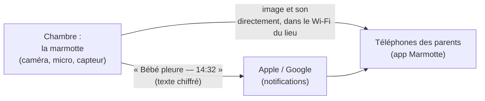

# Marmotte : le babyphone qui garde tout à la maison

> Doc de présentation du projet. Version 1 du 2026-11-19.

## En une phrase

Marmotte est un **babyphone vidéo fait maison** : une petite marmotte imprimée en 3D veille sur la sieste du bébé et prévient les parents sur leur téléphone quand il pleure, **sans que l'image ni le son ne quittent la maison**.

## Pourquoi « Marmotte »

Le bébé dort comme une marmotte. Et chez les marmottes, pendant que les autres se reposent, **une sentinelle fait le guet et siffle** pour prévenir le groupe. C'est exactement le rôle du babyphone.

## Pourquoi le faire soi-même

- **Pour le plaisir** : c'est un projet personnel, et la finition compte.
- **Par économie** : un babyphone vidéo du commerce coûte plus de 100 €, alors que l'essentiel du matériel était déjà là (un Raspberry Pi et une caméra infrarouge).
- **Par confiance** : beaucoup de babyphones connectés font passer l'image et le son de la chambre par les serveurs du fabricant. Marmotte non.

## Ce que fait Marmotte

- **Il écoute le bébé** pendant la sieste et **envoie une notification** quand il pleure, gémit, babille ou crie, au plus quelques secondes après le début du pleur. Les bruits de la maison, les conversations ou la musique ne déclenchent rien.
- **On touche la notification et on arrive sur le live** : l'image (en noir et blanc dans le noir, grâce à l'infrarouge) et le son, avec moins d'une seconde de délai, et un zoom au doigt.
- **Deux modes** : **Sieste** (alertes actives) et **Surveillance silencieuse** pour un moment de jeu dans la chambre (image et son sans alerte), qui repasse tout seul en Sieste à la fin de la durée choisie.
- **Les parents choisissent qui reçoit les alertes** : les deux téléphones, ou un seul, en un geste (« Je prends les alertes »).
- **Il affiche la température et l'humidité** de la chambre, en vert, jaune ou orange.
- **Il se surveille lui-même** : si la caméra, le micro ou l'écoute plante, il le relance et prévient. L'app montre en permanence s'il est en ligne et si l'image et le son arrivent.
- **Il voyage** : maison, amis, famille, salle des fêtes. Dans un lieu déjà connu, il suffit de le brancher ; ailleurs, on lui donne le Wi-Fi depuis le téléphone, sans écran ni clavier. Dans un lieu public, il se connecte au partage de connexion d'un téléphone.
- **Il se met à jour à la demande**, et revient tout seul à la version précédente si quelque chose ne va pas.

## Comment ça marche

- Dans la marmotte, un **Raspberry Pi 4** avec une caméra infrarouge, un micro et un capteur de température et d'humidité.
- Une **petite intelligence artificielle**, qui tourne **sur le Pi lui-même**, reconnaît les pleurs.
- Côté parents, une **app web installée sur l'écran d'accueil** de l'iPhone et de l'Android : rien à télécharger sur les stores.

## Ce que Marmotte ne fait pas

- **Il n'enregistre rien** : ni image, ni son, ni replay.
- **Il n'a pas de cloud** ni de compte à créer chez un fabricant.
- **Il ne permet pas de parler au bébé.**
- En V1, **le live se regarde depuis le même Wi-Fi** que la marmotte. Les notifications, elles, arrivent partout.

## Vie privée

- **L'image et le son ne sortent jamais du réseau du lieu.** Ils vont directement de la marmotte au téléphone, chiffrés.
- Les notifications passent obligatoirement par Apple et Google, mais elles ne contiennent **que du texte**, **chiffré de bout en bout** : Apple et Google voient seulement qu'une notification a été envoyée.
- Internet sert aussi aux mises à jour, à l'heure, et à un nom de domaine qui permet au téléphone de trouver la marmotte en toute sécurité (HTTPS). Ces services ne voient jamais la chambre.
- Seuls **les téléphones des parents**, appairés à l'installation, accèdent au live : un invité sur le même Wi-Fi ne voit rien.

## Le matériel

| Élément | |
|---|---|
| Raspberry Pi 4 | Le cerveau |
| Caméra OV5647 infrarouge, avec LED | Vision de nuit |
| Micro numérique INMP441 | L'écoute |
| Capteur Sensirion SHT31-D | Température et humidité |
| Boîtier imprimé en 3D en forme de marmotte | Cache tout, se fixe sur un trépied |
| Alimentation secteur, ou batterie externe | Pour les lieux sans prise |

## Où en est le projet

- **Fait** : besoin, fonctions et choix techniques arrêtés.
- **En cours** : construction de la première version (V1). Le boîtier en forme de marmotte vient en dernier.
- **Plus tard** : regarder le live depuis n'importe où grâce à un tunnel chiffré vers la maison, un veilleur qui prévient si la marmotte s'éteint, une berceuse sur une enceinte.

## Licences

- **Code** : sous **PolyForm Noncommercial 1.0.0**. C'est du **code source ouvert, à usage non commercial** : on peut le lire, le copier, le modifier et le partager, mais pas le vendre. Ce n'est pas de l'« open source » au sens de l'Open Source Initiative.
- **Modèles 3D et documentation** : sous **Creative Commons BY-NC-SA 4.0** (attribution, pas d'usage commercial, partage dans les mêmes conditions).

## Avertissement

Marmotte est un **projet personnel**. Ce n'est **ni un dispositif médical, ni un produit certifié**, et il ne remplace pas la surveillance d'un adulte. Une notification peut arriver en retard ou ne pas arriver (téléphone en économie d'énergie, mode Ne pas déranger, coupure d'internet). Les câbles doivent rester **hors de portée du bébé**, à plus d'un mètre du lit.
