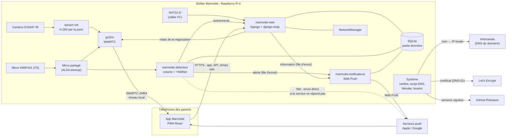
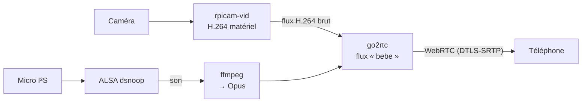
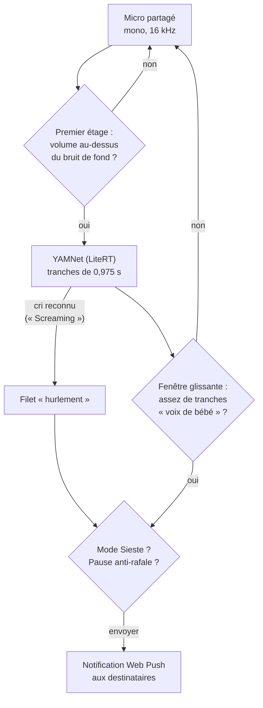
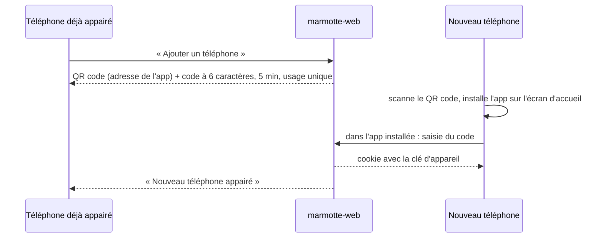
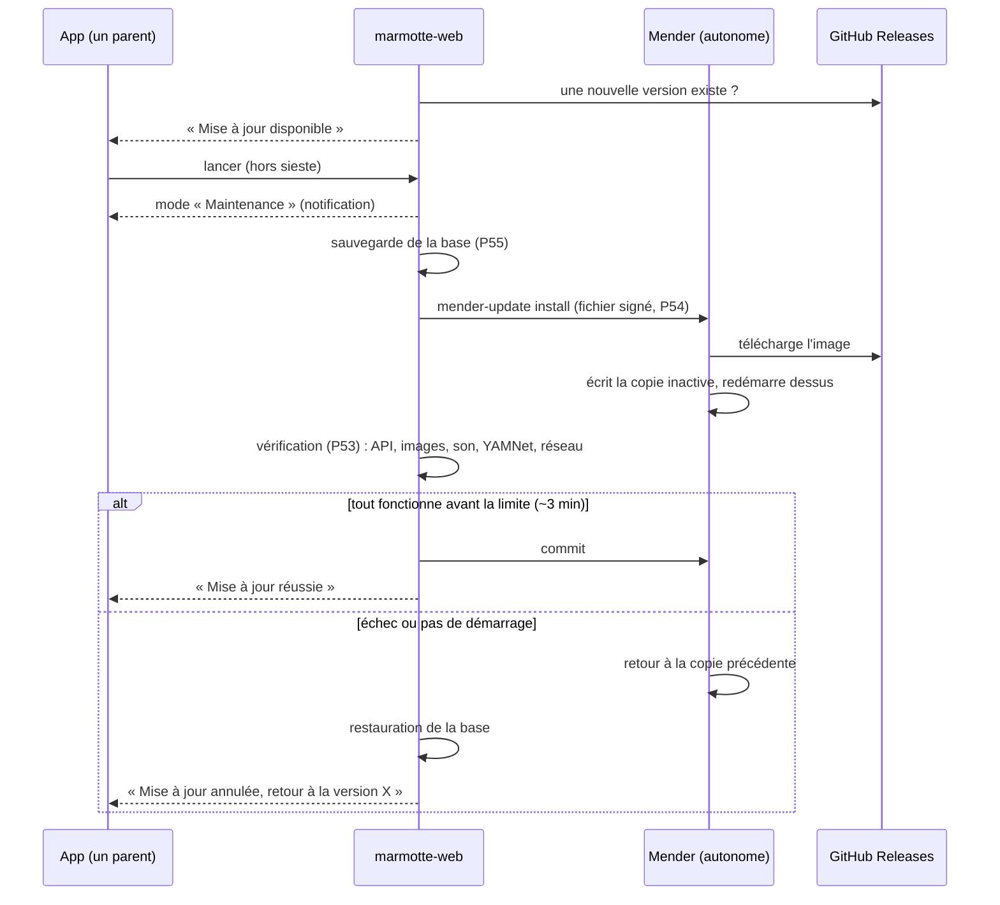
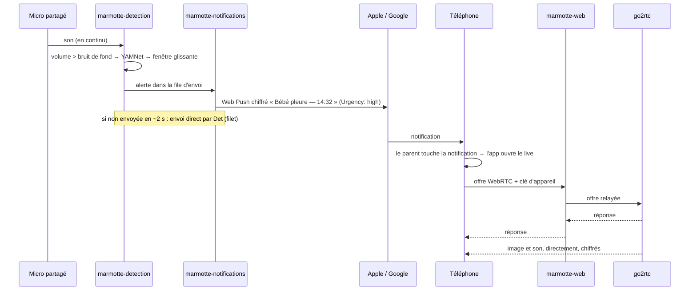

# Marmotte : choix techniques et architecture

> **Statut** : version 2 du 2026-11-19, relue par un relecteur indépendant, **validée par l'auteur le 2026-11-19** (D85). Ce document tient lieu de **specs techniques** du projet ; la partie boîtier est dans `docs/technique/modelisation-3d.md`, le comportement attendu dans `docs/fonctionnel/specs-fonctionnelles.md`.
> **Origine** : le journal des décisions du projet (notes de brainstorming, non publiées). Les identifiants **Dxx** (décisions), **Pxx** (propositions) et **Tx** (choix techniques) y renvoient ; il contient pour chaque choix le détail des options, de leurs pour et contre, et les sources.
> **Rôle** : expliquer l'architecture de la V1 et la raison de chaque choix, assez précisément pour planifier la construction. Les specs fonctionnelles et techniques détaillées seront rédigées ensuite à partir de ce document.

---

## 1. Résumé

Marmotte est un babyphone vidéo fait maison pour les siestes. Côté bébé, un **Raspberry Pi 4** avec une caméra infrarouge, un micro numérique et un capteur de température et d'humidité, caché dans un boîtier imprimé en 3D en forme de marmotte. Côté parents, une **app web installable (PWA)** sur un iPhone et un Android.

L'architecture tient en quelques lignes :

- **go2rtc** diffuse l'image (compressée par la puce H.264 du Pi) et le son au téléphone en **WebRTC**, en moins d'une seconde, **directement dans le réseau local**.
- Un service Python, **`marmotte-detection`**, écoute le micro et reconnaît les pleurs avec le modèle d'IA **YAMNet** (LiteRT).
- Un service Python, **`marmotte-notifications`**, envoie les **notifications Web Push** pour les autres services, avec un filet qui garantit qu'une alerte de pleur part même s'il est en panne.
- Un service **Django + django-ninja**, **`marmotte-web`**, sert l'app, l'API, l'état en temps réel, l'appairage des téléphones, les réglages, la configuration du Wi-Fi et la surveillance des autres briques.
- Chaque service tourne **séparément** (D82) : la panne de l'un n'emporte pas les autres.
- Un nom de domaine à soi, chez **Infomaniak** (D93), qui pointe vers l'IP locale du Pi, et un certificat **Let's Encrypt** donnent le HTTPS exigé par la PWA, sans exposer le Pi à internet.
- Le système est une **image A/B** (deux copies du système sur la carte SD), mise à jour à la demande avec **retour arrière automatique**.
- L'app est en **React** et TypeScript, avec **React Three Fiber** pour la 3D.

Rien du bébé (image, son) ne sort du réseau local. Internet sert seulement aux notifications, aux mises à jour, à la mise à jour du nom et au certificat.

---

## 2. Contexte

### 2.1 Le projet

- **Usage** : surveiller le bébé **pendant ses siestes** (D1), dans un lieu qui change : maison, amis, famille, salle des fêtes (D2).
- **Utilisateurs** : les **deux parents**, un iPhone et un Android (D3, D33). Pas d'accès invité en V1.
- **Deux usages** : regarder le **live avec le son** de temps en temps ; recevoir une **notification** quand le bébé pleure, la toucher et arriver directement sur le live (D4, D5).
- **Pourquoi le faire soi-même** : pour le fun, par économie (le matériel principal est déjà là), et par méfiance envers le traitement des données des babyphones du commerce (§ 1 des notes).

### 2.2 Ce qui serait un échec, même si « ça marche »

- **La panne silencieuse** : image figée, son coupé ou Wi-Fi tombé, alors que les parents croient que tout fonctionne.
- **Le pleur manqué** : c'est l'erreur la plus grave ; une fausse alerte en plus est acceptable (D23).
- Le flux vidéo ou son qui **passe par un tiers** ou devient public (D9).
- Une **installation sur place longue ou pénible** (écran, clavier, configuration manuelle).

### 2.3 Périmètre

| V1 | Plus tard (V2 et au-delà) | Exclu |
|---|---|---|
| Live image et son en réseau local ; détection des pleurs et notifications ; modes Sieste et Surveillance silencieuse ; température et humidité affichées ; configuration du Wi-Fi sans écran ; appairage des deux téléphones ; mises à jour à la demande avec retour arrière ; boîtier imprimé | Live à distance par tunnel WireGuard (D18) ; veilleur à la maison (D27) ; berceuse sur enceinte externe (D40) ; module batterie intégré (D38) ; alertes et courbes de température (D43) ; accès invité (D33) ; affinage de l'IA avec les enregistrements du bébé | Enregistrement et replay (D6) ; parler au bébé (D39) ; veilleuse intégrée (D42) |

### 2.4 Calendrier (D80)

- Le délai de la V1 est **court**.
- **Une seule version V1, avec le maximum de fonctions** de la colonne V1 ci-dessus. Pas de version réduite intermédiaire.
- Le **boîtier imprimé vient en dernier**, une fois que le projet fonctionne et que la détection a été validée sur des **pleurs trouvés sur internet**.
- Ordre de construction : voir § 18.1.

---

## 3. Exigences qui pilotent l'architecture

| Exigence | Source | Conséquence technique |
|---|---|---|
| Live avec **moins d'une seconde de délai** ; 1080p à 25-30 images/s si possible, sinon 720p ; son mono qualité voix ; zoom au doigt ; noir et blanc la nuit | D45 | **WebRTC** ; compression par la **puce H.264** du Pi ; zoom fait dans l'app |
| Le flux ne passe **jamais par un tiers** ; live visible **seulement depuis le réseau local** en V1 | D9, D10 | Le WebRTC circule directement du Pi au téléphone ; pas de serveur relais |
| Internet seulement pour : notifications, mises à jour, mise à jour du nom, certificat | D11, D66 | Aucun service cloud ; le DNS et le certificat sont les seuls ajouts |
| **HTTPS** reconnu par les téléphones et **nom stable** d'un lieu à l'autre | D15, P7 | Nom à soi chez Infomaniak + certificat Let's Encrypt (T6, D93) |
| Notification **au plus ~8 s** après le début d'un pleur qui dure ; un **hurlement jamais raté** | D24, D25 | Détection en deux étages, fenêtre glissante, filet « hurlement », programme de détection isolé |
| **Panne silencieuse, niveau B** : état clair dans l'app, grosse alerte si le babyphone ne répond pas ; le Pi relance un composant planté et notifie | D26 | Surveillance par `marmotte-web`, relance par systemd, caméra allumée en permanence |
| Modes **Sieste** et **Surveillance silencieuse**, compte à rebours de 30 s au démarrage, retour automatique en Sieste | D28 à D32, P20 à P23 | Machine à états dans `marmotte-web`, lue par `marmotte-detection` |
| Choix des **téléphones qui reçoivent les alertes**, au moins un en Sieste | D34 à D37, P24 à P29 | Chaque téléphone est identifié (T7) ; abonnements Web Push par téléphone |
| Température et humidité **affichées** en couleurs, une mesure par minute | D43, D44, P30 à P32 | Capteur SHT31-D déporté (T11) |
| **Mises à jour à la demande**, mode « Maintenance », **retour arrière automatique** | D46 | Image A/B (T9) |
| Installation **sans écran** : le Pi diffuse son propre Wi-Fi de configuration | D14, P3, P4 | Configuration faite maison sur NetworkManager (T8) |
| Code sous **PolyForm Noncommercial**, modèles 3D et docs sous **CC BY-NC-SA** ; pas de dépendance non commerciale ; code GPL seulement comme programme séparé | D55 à D57, § 6.12 | Choix de dépendances sous licences permissives (MIT, Apache, BSD, MPL) |
| Interface et docs **en français**, code et commits **en anglais** | D51, D52 | — |

---

## 4. Vue d'ensemble

| Brique | Rôle | Choix |
|---|---|---|
| **go2rtc** | Lit la caméra (par `rpicam-vid`) et le micro partagé, réunit image et son dans un flux, le sert en WebRTC | T2, D59 |
| **Micro partagé** | Permet au live et à la détection de lire le micro chacun de son côté | T3, D60 |
| **`marmotte-detection`** | Chaîne critique : micro → premier étage au volume → YAMNet → décision → alerte | T4, D62, D82 |
| **`marmotte-notifications`** | Envoi de toutes les notifications Web Push : destinataires, clés VAPID, priorité, abonnements invalides, nouvelles tentatives | D82, P73 |
| **`marmotte-web`** | App, API, temps réel (SSE), appairage, réglages, modes, relais WebRTC, capteur, configuration réseau, surveillance | T5, D63 |
| **SQLite** | Réglages, téléphones, abonnements, mode en cours | D64 |
| **NetworkManager** | Réseaux connus, Ethernet, point d'accès de configuration | T8, D69 |
| **Système** | Image A/B (Mender), certificat (certbot), mise à jour du nom (API Infomaniak), bouton de réinitialisation | T6, T7, T9 |
| **App** | PWA React + TypeScript, live WebRTC, 3D, notifications | T10, D73 |

**Principe d'indépendance (P34, D82)** : le live et la détection lisent chacun le micro ; chaque fonction tourne dans son propre service, relancé seul en cas de panne. Un plantage de l'API, du live ou même du service de notifications n'empêche pas d'être prévenu d'un pleur (filet du § 8.3).

**Préférence pour des services séparés** (« voire du micro-service », D82) : elle s'applique aussi aux points laissés au constructeur (§ 21), comme la logique réseau ou la surveillance du bouton. On sépare un service quand sa panne ne doit pas emporter les autres.

---

## 5. Matériel

| Élément | Choix | Branchement | Notes |
|---|---|---|---|
| Ordinateur | **Raspberry Pi 4** (possédé) | — | Révision 1.4, 8 Go (vérifié au lot 0) : pas concerné par le refus des câbles USB-C « e-marqués », propre à la révision 1.1 (§ 6.9). |
| Caméra | **Quimat OV5647 IR-Cut**, LED IR (possédée) | Nappe CSI ; commande du filtre IR-Cut sur GPIO 17 | Pilotée par la pile officielle (`rpicam-apps`), détectée sans overlay. Les LED IR s'allument seules dans le noir (une photorésistance par carte LED). Le filtre IR-Cut **ne bascule pas seul** : sa commande (une pastille à 1,8 V) est reliée à GPIO 17 par 1 kΩ, en drain ouvert (niveau bas = nuit, entrée sans tirage = jour, `gpio=17=ip,pn` au démarrage, jamais de 3,3 V). Détails : `docs/plans/resultats-tests-prealables.md`. |
| Micro | **INMP441**, numérique I²S | GPIO 18, 19, 20 ; L/R à GND | Overlay `googlevoicehat-soundcard` avec `dtparam=i2s=on` (vérifié au lot 0). Son sur le canal gauche seulement (§ 7.3). |
| Capteur | **Sensirion SHT31-D** sur carte à broches (acheté à la place du SHT40/41 à connecteur Qwiic de D76) | I²C, GPIO 2 et 3, adresse 0x44 | Broches à souder, fils Dupont femelle-femelle. Au bout d'un câble de **30 à 50 cm**, dans un compartiment séparé et ventilé (P61). |
| Bouton | **Bouton poussoir de réinitialisation**, caché (trou « trombone ») | Une broche GPIO libre | P43. |
| Stockage | Carte microSD de **32 Go** conseillée | — | Deux copies du système + partie données (T9). |
| Alimentation | Secteur 5,1 V / 3 A en USB-C ; **batterie UGREEN PB722** en dépannage | USB-C | Le Pi ne connaît pas le niveau de la batterie (§ 6.9). Module batterie intégré plus tard (D38). |
| Refroidissement | Boîtier alu à deux ventilateurs, gardé pour l'instant | — | Refroidissement passif à évaluer (D50, P33) : bruit capté par le micro. |

Les contraintes du boîtier imprimé (aération, fenêtre caméra et LED IR, micro loin du bruit, capteur isolé, passages de câbles, place pour une batterie, pas de vis photo 1/4" et rotule, câbles à plus d'un mètre du lit, forme de marmotte) sont regroupées au § 6.11 des notes. S'y ajoutent : le **trou du bouton de réinitialisation** (P43), le **compartiment du capteur** (P61) et l'**emplacement de l'étiquette** (P47).

---

## 6. Système du Pi (T9)

### 6.1 Base

- **Raspberry Pi OS Lite 64 bits**, basé sur Debian 13 « Trixie » (P51). Le 64 bits est imposé par LiteRT ; la version Lite n'a pas de bureau.
- Python **3.14**, la dernière version pour laquelle toutes les bibliothèques existent (D94) : LiteRT ne publie rien pour 3.15. Raspberry Pi OS Trixie fournit Python 3.13 ; **uv installe lui-même Python 3.14** et l'environnement virtuel (D58, P65). Passer à 3.15 dès que LiteRT le permettra.

### 6.2 Découpage de la carte SD (image A/B, D71)

| Partie | Contenu |
|---|---|
| Démarrage | Micrologiciel du Pi et U-Boot (ajouté par mender-convert) |
| Système A | Raspberry Pi OS + Marmotte, version courante ou précédente |
| Système B | L'autre version |
| **Données** (`/data`) | Base SQLite, certificat TLS et sa clé, clés VAPID, jeton d'API Infomaniak, réseaux Wi-Fi connus (connexions NetworkManager), secrets propres au boîtier, sauvegarde de la base avant mise à jour |

La partie système pourra passer **en lecture seule** pour limiter les dégâts quand on débranche sans éteindre (P52, à étudier pendant la construction de l'image).

### 6.3 Services

| Service (systemd) | Rôle | Relance |
|---|---|---|
| `go2rtc` | Live | Automatique ; surveillé par `marmotte-web` |
| `marmotte-detection` | Détection des pleurs et décision d'alerte | Automatique, avec chien de garde systemd |
| `marmotte-notifications` | Envoi des notifications Web Push | Automatique, avec chien de garde systemd |
| `marmotte-web` | App, API, surveillance | Automatique, avec chien de garde systemd |
| Tâche certbot | Renouvellement du certificat | Minuterie systemd |
| Script de NetworkManager (« dispatcher ») | Mise à jour du nom par l'API d'Infomaniak à chaque changement de réseau | À chaque événement réseau |
| Mender (mode autonome) | Installation des mises à jour | Lancé par `marmotte-web` à la demande |

Les services tournent sous un utilisateur dédié sans privilèges, avec les seuls accès nécessaires (caméra, son, I²C, GPIO, pilotage de NetworkManager).

### 6.4 Construction de l'image

Un **seul script de préparation du système** (P64) installe les paquets, go2rtc, les services, la configuration ALSA et NetworkManager. Il sert à la fois :

- dans l'intégration continue, pour construire l'image : Raspberry Pi OS Lite + script + Marmotte (back, front construit, modèle YAMNet), convertie par **mender-convert** en un fichier `.img` (première installation : on flashe la carte) et un fichier `.mender` (mise à jour), **signés** (P54) ;
- sur le Pi de développement (T12), pour qu'il ne diverge pas de l'image.

### 6.5 Préparation d'un boîtier (proposition de rédaction)

Les secrets propres à chaque boîtier doivent être connus **avant** le premier démarrage, puisqu'ils sont imprimés sur l'étiquette (P47) : mot de passe du réseau de configuration (P49) et code d'appairage initial (P40). Proposition : un **outil de préparation** lancé sur le PC après le flashage de la carte SD. Il génère ces secrets, les écrit dans la partie données, demande le **domaine et le jeton d'API Infomaniak de la personne qui prépare le boîtier**, crée le nom du babyphone dans ce domaine (P39) et produit l'**étiquette à imprimer** (QR code du réseau de configuration, mot de passe, adresse de la page de configuration, code d'appairage initial).

**Public visé** (arbitrage de Claude) : la V1 vise **un seul boîtier, celui de l'auteur**. L'image publiée ne contient **aucun secret** : chaque personne qui prépare un boîtier utilise **son propre nom de domaine** (chez Infomaniak ou, plus tard, un autre fournisseur pris en charge) et son propre jeton. Le README expliquera la démarche aux autres utilisateurs ; un premier démarrage « générique », sans outil de préparation, n'est pas prévu en V1.

---

## 7. Live : image et son (T2, T3)

### 7.1 Chaîne

- **Image** : go2rtc lance `rpicam-vid` (source `exec`), qui sort un flux H.264 compressé par la puce. Réglages par les options de `rpicam-vid` : résolution, images par seconde, débit, profil H.264.
- **Son** : go2rtc lit le **micro partagé** (`dsnoop`) par `ffmpeg`, avec un gabarit d'entrée nommé dans la section `ffmpeg:` de sa configuration, et le compresse en **Opus**, mono, qualité voix. La source `alsa` de go2rtc est exclue : elle ouvre le micro directement et contourne `dsnoop`. Configuration testée et pièges : `docs/plans/resultats-tests-prealables.md`, tâche 5.
- **Un seul flux** pour l'image et le son : go2rtc réunit les pistes de plusieurs sources.
- **Caméra allumée en permanence** (`preload`, D61) : le Pi vérifie la caméra en continu et le live s'ouvre tout de suite depuis une notification. Un réglage « **caméra à la demande** » dans l'app permet de l'éteindre quand personne ne regarde, si la consommation pose problème (notamment sur batterie). L'app affiche alors « caméra en veille » au lieu d'une alerte.

### 7.2 Accès au live

- go2rtc **n'écoute pas le réseau** pour son API : `127.0.0.1` seulement. Les modules inutiles (interface web…) sont désactivés. Le serveur RTSP reste actif, mais sur `127.0.0.1` seulement : la source `ffmpeg` du son y publie sa piste. Seul le port WebRTC (8555 par défaut) est ouvert sur le réseau local.
- Le téléphone demande le live à **`marmotte-web`** (requête authentifiée par la clé d'appareil, T7), qui **relaie la négociation WebRTC** (offre et réponse SDP) vers l'API de go2rtc. Sans négociation passée par `marmotte-web`, aucun appareil n'obtient le flux.
- En V1, la connexion WebRTC reste dans le réseau local : pas de serveur STUN ou TURN.

### 7.3 Micro partagé

- `/etc/asound.conf` définit un périphérique `dsnoop` au-dessus du micro I²S, avec une conversion (`plug`) vers les formats demandés par chaque lecteur. Vérifié au lot 0 avec deux lecteurs simultanés.
- L'INMP441 (L/R à GND) n'émet que sur le **canal gauche** ; le droit est un silence numérique. Un lecteur qui demande du mono à `plug` obtient la moyenne des deux canaux, donc un son à -6 dB : lire en stéréo et garder le canal gauche, ou ajouter un module `route` qui ne garde que le gauche (à tester).
- **Repli** si `dsnoop` se comporte mal avec le micro I²S : **PipeWire** comme service du système (D60).

---

## 8. Détection des pleurs (T4)

### 8.1 Chaîne dans `marmotte-detection`

1. **Lecture** du micro partagé, **canal gauche** (§ 7.3), en 16 kHz, valeurs entre -1 et 1 (format d'entrée de YAMNet).
2. **Premier étage** (P11) : le niveau sonore, comparé à un **bruit de fond qui s'adapte** au lieu. L'IA ne tourne que lorsqu'un son dépasse ce bruit de fond. Le niveau se mesure **après un filtre passe-haut** (vers 60 à 100 Hz) : le micro capte des variations de pression lentes (1 à 2 Hz), inaudibles, qui dominent le niveau brut du silence (-50 dBFS, contre -68 dBFS après filtrage, lot 0). La charge ne l'impose pas : YAMNet sur toutes les tranches ne coûte que 6 % d'un cœur (lot 0).
3. **YAMNet** avec **LiteRT** (`ai-edge-litert`), sur des tranches de 15 600 échantillons (0,975 s). Catégories retenues (P10) : « Baby cry, infant cry », « Whimper », « Babbling », « Baby laughter », et « Screaming » pour le filet (P16). Les bruits d'objets ne déclenchent rien.
4. **Fenêtre glissante** (P18) : décision sur plusieurs tranches récentes (ex. 2 tranches « pleur » sur les 4 dernières), pour tenir les **~8 secondes** entre le début d'un pleur qui dure et l'envoi de la notification (D24).
5. **Filet « hurlement »** (P16, P17) : une alerte part, quelle que soit la réponse de l'IA, si le son dépasse **nettement** le bruit de fond pendant environ une seconde, ou si YAMNet reconnaît un cri. Il passe outre la pause anti-rafale.
   *Amendé le 2026-11-25 (banc d'essai, lot 2)* : le filet ne part plus que si YAMNet reconnaît un cri (« Screaming »). Sur le niveau seul, il donnait 27 à 160 fausses alertes par 2 heures de bruits de fond (toux, casseroles, musique), quel que soit le réglage, contre une au plus visée (§ 8.2.1). Un cri que YAMNet ne reconnaît pas n'est plus rattrapé par le filet : 2 cris sur 8 du banc. Il garde sa propre pause, pour ne pas sonner à chaque respiration d'un long cri.
6. **Sensibilité réglable** dans l'app (P13), qui agit sur les seuils.
7. **Mode** : notifications seulement en **Sieste** (D29). En Surveillance silencieuse, ni alerte ni filet (P23).
8. **Pas de rafale** (P12) : une notification, puis une pause réglable avant la suivante.
9. **Envoi** : l'alerte est déposée dans la **file d'envoi** et confiée à `marmotte-notifications`, qui l'envoie aux destinataires en priorité haute (`Urgency: high`, P19), avec un texte explicite, ex. « Bébé pleure — 14:32 » (P14). Voir le filet du § 8.3.
10. **Événements** vers `marmotte-web` (niveau du micro, dernière détection, signe de vie), par un canal local, pour l'état en temps réel et la surveillance.

### 8.2 Précautions (D62)

- **Modèle isolé** derrière une interface simple (une tranche de son en entrée, les scores des catégories retenues en sortie). Passer à un autre modèle (ex. EfficientAT) ne toucherait que cette partie.
- **Banc d'essai** : des enregistrements de pleurs, gémissements, babillages et bruits de fond (maison, conversation, musique de salle des fêtes). Il mesure les **pleurs manqués** et les **fausses alertes**, tourne dans l'intégration continue et bloque la fusion d'une modification qui fait reculer la détection (P67).

### 8.2.1 Sources et objectifs du banc d'essai (D81)

- **Sources** : le banc s'appuie uniquement sur des **sons d'internet sous licence libre** : extraits **CC0** ou **CC BY** de Freesound (licence vérifiée extrait par extrait), avec un fichier de crédits pour les extraits CC BY. **Exclus** : les jeux de données sous licence non commerciale (ESC-50, CryCeleb…), contraires au § 6.12.
- **Vidéos YouTube** : utilisables seulement pour des **essais à la main, en local**. Elles ne sont pas sous licence libre en général : elles n'entrent ni dans le dépôt ni dans l'intégration continue.
- **Objectifs** (seuils bloquants de P67) :
  - **zéro pleur manqué** parmi les pleurs qui durent **plus de 8 secondes** ;
  - **au plus une fausse alerte par sieste de 2 heures**, mesurée sur au moins 2 heures de bruits de fond variés sans pleur.
- **Plus tard** : enrichir le banc avec les enregistrements du bébé, **gardés en local**, jamais publiés.

### 8.3 Filet des notifications (P73)

Le service `marmotte-notifications` ajoute un intermédiaire sur le chemin critique. Pour qu'il ne devienne pas une cause de pleur manqué :

- chaque alerte est d'abord **écrite dans une file d'envoi** (table SQLite, identifiant unique) : rien ne se perd si un service redémarre ;
- `marmotte-notifications` est prévenu tout de suite par un canal local, envoie, puis marque l'alerte comme envoyée ;
- **si l'alerte n'est pas marquée comme envoyée en 2 secondes environ** (service en panne ou bloqué), `marmotte-detection` l'envoie **lui-même**, avec la même bibliothèque d'envoi partagée, puis la marque ; l'identifiant unique évite le double envoi ;
- les notifications d'information (changement de mode, panne, mise à jour…) passent par la même file, sans ce filet.

### 8.4 Limites connues

- YAMNet reconnaît « un bébé qui pleure », pas « ce bébé-là » : un autre enfant qui pleure fort près du micro peut déclencher une alerte.
- Le délai total d'une alerte = détection (≤ ~8 s visé) + livraison par Apple ou Google, qui n'est **pas garantie** (économie d'énergie, Android en veille profonde, modes Concentration).
- La charge réelle de YAMNet pendant que la vidéo tourne reste **à mesurer** (D22).

---

## 9. Service web (T5)

### 9.1 Pile

- **Django 6** + **django-ninja**, servi en **ASGI** par **Uvicorn**. La plupart des fonctions restent synchrones ; l'asynchrone est réservé au temps réel et au relais vers go2rtc (§ 10.6 des notes : pièges du mélange synchrone / asynchrone).
- **SQLite** en mode WAL, dans la partie données (D64).
- **pywebpush** (MPL 2.0) pour les notifications, dans une **bibliothèque d'envoi partagée** utilisée par `marmotte-notifications` (et par le filet de `marmotte-detection`), avec des **clés VAPID** générées sur le Pi et rangées dans la partie données.
- Le schéma **OpenAPI** produit par django-ninja sert à générer le client typé du front (P57).

### 9.2 Ce que fait `marmotte-web`

| Fonction | Détail |
|---|---|
| Servir l'app | Les fichiers de la PWA React construite (P60) |
| API | État, modes, réglages (sensibilité, pause anti-rafale, caméra permanente ou à la demande, correction de température), téléphones et appairage, destinataires des alertes, réseaux Wi-Fi, mises à jour |
| **Temps réel** | Flux **SSE** vers l'app ouverte (P36) : en ligne, âge de la dernière image, micro actif, IA active, mode et compte à rebours, température et humidité avec l'heure de la mesure, mise à jour disponible, destinataires |
| Relais WebRTC | Vérifie la clé d'appareil, transmet l'offre à go2rtc, renvoie la réponse |
| **Modes** | Machine à états : démarrage → prêt (caméra, micro et réseau opérationnels) → compte à rebours de 30 s, live disponible (P20) → **Sieste** ; **Surveillance silencieuse** pour une durée choisie, puis retour en Sieste avec notification (D32) ; **Maintenance** pendant une mise à jour ; après tout redémarrage, retour en Sieste après le compte à rebours (P21) |
| Notifications d'information | Changement de mode, panne détectée, « Mode sieste réactivé », résultat d'une mise à jour, téléphone retiré (P27, P28) : déposées dans la file d'envoi de `marmotte-notifications`, aux mêmes destinataires que les alertes |
| Abonnements invalides | Signalés par `marmotte-notifications` quand Apple ou Google refusent un abonnement (désinstallation, autorisation retirée) ; `marmotte-web` l'affiche et l'autre téléphone est prévenu (P29) |
| **Surveillance** (D26) | go2rtc (des images arrivent), `marmotte-detection` (signe de vie, son reçu), `marmotte-notifications` (signe de vie, file d'envoi qui se vide), capteur ; relance du composant et notification en cas de panne |
| Capteur | Mesure au démarrage du mode Sieste puis toutes les minutes, en Sieste comme en Surveillance silencieuse (D43, P30) |
| Réseau | Pilotage de NetworkManager (T8) et page du portail captif |

### 9.3 Données (esquisse)

| Donnée | Contenu |
|---|---|
| Téléphone | Nom, empreinte de la clé d'appareil, dernière activité, destinataire des alertes oui ou non, abonnement Web Push |
| Réglages | Sensibilité, pause anti-rafale, caméra permanente ou à la demande, décalage de température |
| Mode | Mode en cours, fin prévue de la Surveillance silencieuse |
| Appairage | Code initial (actif ou non), invitations en cours (code, expiration, usage unique), compteurs d'essais |
| Mises à jour | Version installée, version disponible, date de première disponibilité (rappel au bout de ~15 jours, D46) |

Aucun enregistrement d'image ni de son n'est stocké (D6).

---

## 10. Réseau (T8)

### 10.1 Ordre de connexion

1. **Ethernet** s'il est branché.
2. **Réseaux Wi-Fi connus**, retenus par NetworkManager (P3).
3. Si rien ne répond **au démarrage** au bout d'environ **45 secondes**, le Pi ouvre son **réseau de configuration** (P48). Une coupure en cours de sieste ne l'ouvre pas : le Pi retente ses réseaux connus.

### 10.2 Réseau de configuration

- Point d'accès créé par NetworkManager en mode « partagé », protégé par un **mot de passe propre au boîtier**, imprimé sur l'étiquette (P49).
- **Portail captif** : le DNS du Pi répond à tous les noms par sa propre adresse, et `marmotte-web` sert la page de configuration (en HTTP sur l'adresse du point d'accès), qui s'ouvre toute seule sur le téléphone. À **tester** sur iPhone et Android : NetworkManager lance son propre dnsmasq et la redirection de tous les noms est signalée comme capricieuse.
- **L'app fonctionne aussi** sur ce réseau (P50) : le DNS du Pi répond au nom public par l'adresse du Pi, et le certificat reste valide sans internet. Un téléphone déjà appairé peut donc choisir le Wi-Fi depuis l'app.
- **Filet de sécurité** : l'étiquette (P47) donne un QR code pour rejoindre le réseau et l'adresse de la page, à ouvrir à la main.

### 10.3 Réseaux ajoutés à l'avance (P46)

Depuis l'app, à la maison, on enregistre le Wi-Fi des grands-parents et le **partage de connexion de chaque téléphone**. Sur place, il suffit de brancher. L'app liste les réseaux connus et permet d'en supprimer. **À vérifier** : un partage de connexion d'iPhone déjà connu est-il retrouvé sans ouvrir l'écran « Partage de connexion » ?

---

## 11. Nom et HTTPS (T6)

- Un **nom de domaine du propriétaire du boîtier**, acheté chez **Infomaniak** (D93), avec un sous-domaine **neutre** pour le babyphone (ex. `bebe.<domaine>.fr`, P39), dont l'enregistrement DNS pointe vers l'**IP locale** du Pi. Les inscriptions gratuites `dedyn.io` de deSEC, prévues au départ, sont suspendues depuis septembre 2026 (§ 10.7 des notes).
- À chaque changement de réseau, le script de NetworkManager **met à jour l'enregistrement** par l'**API d'Infomaniak** (`PUT /2/zones/{zone}/records/{record}`, jeton aux droits `dns:read` et `dns:write`, durée de cache de **60 s**, le minimum permis). Si l'Ethernet et le Wi-Fi sont tous deux connectés, l'adresse publiée est celle de l'interface préférée (Ethernet).
- **certbot** avec l'extension officielle **`certbot-dns-infomaniak`** (même jeton) obtient et renouvelle le certificat Let's Encrypt par **défi DNS** : le Pi n'est jamais exposé à internet, aucun port n'est ouvert sur la box. Le certificat et sa clé sont dans la partie données ; le service qui sert le HTTPS est rechargé après chaque renouvellement.
- **Ce que voient les tiers** : Infomaniak voit le nom, l'IP privée du moment et l'IP publique du lieu lors des mises à jour ; Let's Encrypt voit le nom ; le nom est public (journaux de certificats). Personne ne voit l'image, le son ou le contenu des notifications.
- **Risques acceptés** : si internet tombe sur le lieu, le téléphone ne trouve plus le Pi après environ une minute (les notifications tombent aussi) ; certains réseaux refusent un nom public qui pointe vers une IP privée (protection « DNS rebinding »). **Test obligatoire avant d'écrire le code** (D65) ; parades sur le téléphone : « DNS privé » sur Android, profil DNS sur iPhone.
- **V2** : le nom pointera vers l'adresse fixe du Pi dans le tunnel WireGuard, sans plus de mise à jour.

L'explication pas à pas de ce mécanisme est au § 10.7 des notes (« Option A expliquée simplement »).

---

## 12. Appairage et sécurité (T7)

### 12.1 Preuve d'appairage

- À l'appairage, le Pi crée une **clé d'appareil** aléatoire et longue, déposée dans un cookie **`HttpOnly`, `Secure`, `SameSite=Strict`, persistant** (ex. un an, prolongé à chaque usage). Le Pi n'en garde qu'une **empreinte** (D67).
- Cette clé protège l'**API**, le **temps réel** et le **relais WebRTC**. Restent publics : les fichiers de l'app (sans secret), la page du portail captif (sur le réseau de configuration seulement) et l'appairage (limité contre les essais en série).
- Raisons propres à l'iPhone : l'app installée a un stockage **séparé de Safari**, et Safari efface au bout de 7 jours ce qu'écrit le JavaScript, mais pas un cookie `HttpOnly` posé par le serveur. **L'appairage se fait donc dans l'app installée.** Un bug d'iOS 17 efface parfois les cookies de session : d'où un cookie **persistant**. Comportement **à tester sur la durée**.

### 12.2 Accepter un téléphone (D68)

- **Premier téléphone** : le **code d'appairage initial** de l'étiquette, valable seulement quand aucun téléphone n'est appairé (P40).
- **Téléphones suivants** : invitation depuis un téléphone appairé (P41, schéma ci-dessus).
- **Retrait** depuis la liste des téléphones, sur n'importe quel téléphone appairé ; le dernier destinataire des alertes ne peut pas être retiré en Sieste (P42, P26).
- **Bouton de réinitialisation** maintenu une dizaine de secondes : efface tous les appairages et réactive le code initial (P43).
- **Limites** contre les essais en série sur les codes (P44).
- Un téléphone qui n'est plus reconnu l'affiche clairement : « Ce téléphone n'est plus appairé » (P45).

### 12.3 Secrets

Mot de passe du réseau de configuration, code d'appairage initial, empreintes des clés d'appareil, clés VAPID, jeton d'API Infomaniak, clé du certificat : **tous dans la partie données du Pi**, jamais dans le dépôt public (§ 6.12). La clé privée qui signe les mises à jour est dans les secrets de GitHub Actions.

---

## 13. App des parents (T10)

### 13.1 Pile

- **React 19**, **TypeScript** (P56), construit par **Vite** avec son extension PWA (manifeste, service worker).
- 3D : **React Three Fiber**, **drei** ; animations : **Motion**.
- **Client d'API typé**, généré à partir du schéma OpenAPI de django-ninja (P57).
- Tests : **Vitest**, **Playwright** ; style : **ESLint**, **Prettier** (P66).

### 13.2 Téléphones cibles (D84)

| Téléphone | Système | Navigateur | Conséquences |
|---|---|---|---|
| iPhone | **iOS 27** | **Brave** par défaut | Brave **ne sait pas installer** une app web sur l'écran d'accueil sous iOS : l'installation se fait **une fois depuis Safari** (Partager → « Sur l'écran d'accueil », option « Ouvrir comme app web » activée). Ensuite, l'app installée fonctionne seule, notifications comprises, sans Brave. Un QR code scanné (invitation, P41) s'ouvre dans Brave : le guide d'installation dira de l'ouvrir dans Safari. **À vérifier** sur iOS 27. |
| Android | **Android 13** (modèle à préciser) | **Chrome** | Installation normale de la PWA par Chrome ; notifications par les services de Google. |

### 13.3 Fonctionnement

- **PWA installée** sur l'écran d'accueil : obligatoire sur iPhone pour recevoir des notifications (iOS 16.4 et plus). L'app embarque son interface : elle s'ouvre même quand le Pi est injoignable et l'affiche clairement (« tu n'es pas sur le réseau du babyphone », P5).
- **Service worker** : cache de l'interface, réception des notifications, et ouverture directe du live quand on touche une notification (D5).
- **Live** : connexion WebRTC négociée par le relais de `marmotte-web` ; reconnexion automatique ; **zoom au doigt** fait dans l'app (D45).
- **État en temps réel** par SSE ; mode affiché en grand (P22).
- **Écrans** (esquisse) : accueil et état, live, réglages, téléphones et destinataires, réseaux Wi-Fi, mises à jour, appairage, hors réseau, téléphone désappairé.

### 13.4 3D et design

- Le design se traite dans une **session dédiée** (D8).
- **La même marmotte** dans l'app et sur l'étagère : le modèle 3D du boîtier, conçu en code, est exporté en glTF et réutilisé (P58).
- **Sobriété** : la 3D se met en pause pendant le live, et l'app respecte le réglage « réduire les animations » du téléphone (P59).
- **Repli** (D75) : si la 3D animée s'avère trop compliquée ou trop gourmande, une interface « app mobile » en **glassmorphisme** ou en **neumorphisme**. Un **petit prototype de chaque piste** est réalisé pendant le développement du front. On reste sur React dans tous les cas.

---

## 14. Température et humidité (T11)

- **SHT31-D** (±0,3 °C, ±2 % d'humidité ; acheté à la place du SHT40/41 de D76), lu en I²C depuis Python (`smbus2` ou bibliothèque Adafruit).
- Mesure au démarrage du mode Sieste, puis **toutes les minutes** (D43).
- Affichage en **vert / jaune / orange** avec des seuils fixes en V1 (P31, **à sourcer**) ; heure de la dernière mesure ; « capteur indisponible » en gris, sans notification (P32).
- **Décalage de correction** réglable dans l'app, après comparaison avec un thermomètre de référence une fois le boîtier imprimé (P62).

---

## 15. Mises à jour (T9)

- **À la demande** (D46) : l'app affiche « Mise à jour disponible », un parent la lance hors sieste ; un rappel discret apparaît si elle attend depuis longtemps (ex. 15 jours).
- Une mise à jour = une **image complète** (système + Marmotte), de plusieurs centaines de Mo : à faire de préférence à la maison plutôt que sur un partage de connexion.
- Les **correctifs de sécurité du système** arrivent par une **reconstruction mensuelle automatique** de l'image (P70) : pas d'`apt upgrade` sur le Pi en usage.
- Le comportement exact du retour arrière de Mender en mode autonome (redémarrage sans validation, échec de démarrage) est **à vérifier** pendant la mise en place.
- **Lot 0** : l'image pré-convertie de Mender pour Pi 4 (Trixie Lite) démarre avec la caméra (U-Boot ne gêne pas `rpicam-apps`), mais **ne contient pas le client Mender**. Notre image, construite par mender-convert, devra l'installer (option `MENDER_CLIENT_INSTALL`, valeur par défaut à vérifier).

---

## 16. Flux principaux

### 16.1 Un pleur pendant la sieste

### 16.2 Arrivée dans un nouveau lieu

1. On branche le babyphone. Il essaie l'Ethernet, puis les réseaux connus (dont ceux ajoutés à l'avance, P46).
2. Il obtient une adresse ; le script de NetworkManager met à jour le nom chez Infomaniak.
3. Quand caméra, micro et réseau sont prêts, le compte à rebours de 30 s démarre ; le live est déjà disponible pour orienter la caméra (P20).
4. Le babyphone passe en **Sieste**.
5. Si aucun réseau n'est trouvé en ~45 s, il ouvre son réseau de configuration (§ 10.2).

---

## 17. Ce qui sort du Pi

| Destination | Ce qui part | Quand |
|---|---|---|
| Services push d'**Apple** et de **Google** | Notifications **chiffrées de bout en bout** (RFC 8291) ; Apple et Google voient seulement qu'une notification a été envoyée | À chaque notification |
| **Infomaniak** (DNS du domaine) | Le nom et l'IP privée du moment ; l'IP publique du lieu est visible lors de l'appel | À chaque changement de réseau |
| **Let's Encrypt** | Le nom, les demandes de certificat | Tous les ~60 jours |
| **GitHub** | Vérification et téléchargement des versions | À la demande et à une fréquence à définir |
| **Serveurs de temps** (NTP) | Demande de l'heure | Au démarrage ; voir § 20 |
| **Personne** | Image, son, contenu des notifications, données de température | Jamais |

---

## 18. Process de développement (T12)

- **Au quotidien sur le PC** (D78), avec le **matériel simulé** (P63) : chaque matériel (caméra, micro, capteur, bouton) est caché derrière une interface Python avec une version réelle et une version simulée. Caméra simulée : go2rtc lit une vidéo de test en boucle ; micro simulé : les fichiers du banc d'essai.
- **Pi de développement** synchronisé **en une commande** (copie du code, `uv sync`, redémarrage des services), préparé par le même script que l'image (P64).
- **Quel Pi pour le développement** (arbitrage de Claude) : le **Pi 4** jusqu'à la première version utilisable. Ensuite, le Pi 4 devient le babyphone et tourne sur une image publiée. Le développement continue sur le **Pi 3B+** (64 bits possible, même pile caméra, plus lent) tant qu'il ne sert pas de pivot WireGuard (V2), ou sur un second Pi 4. La caméra et le micro peuvent passer d'une carte à l'autre pour les tests.
- **Outils Python** (P65) : uv, ruff, **pyright dans l'intégration continue**, pytest et pytest-django, pre-commit.
- **Outils front** (P66) : TypeScript, Vitest, Playwright, ESLint, Prettier.
- **Un seul dépôt GitHub public** (P69) : `backend/` (Django, django-ninja, détection), `frontend/` (React), `system/` (préparation, services, go2rtc, image), `hardware/` (modèles 3D en code, câblage), `docs/`.
- **GitHub Actions** (P70) : à chaque pull request, style, types, tests back et front, banc de détection (aussi sur machine ARM 64 bits, gratuite pour les dépôts publics) ; à chaque version, front, image, signature, publication ; reconstruction mensuelle de l'image.
- **Flux Git** (P71) : GitHub Flow, branches courtes, fusion par squash, versions SemVer (la version de l'image est celle de l'app). Suivi des tâches dans **GitHub Issues** (D83).
- **Recette sur le vrai matériel avant chaque version** (P68) : endurance du live 1 h, charge du processeur, portail captif sur les deux téléphones, test DNS, délai des notifications, autonomie sur batterie, mise à jour puis retour arrière provoqué, vrais téléphones.
- Un **`CLAUDE.md` propre à Marmotte** au démarrage du code (P72), qui remplace celui hérité d'un autre projet.

### 18.1 Ordre de construction (arbitrage de Claude, à partir de D80)

Le délai de la V1 est **serré**. L'ordre ci-dessous construit d'abord ce qui fait un babyphone, puis ce qui le rend autonome, puis le confort. À tout moment, les parties les plus importantes fonctionnent déjà ; si le temps manque, ce sont les dernières étapes qui glissent.

1. **Achats tout de suite** (délais de livraison) : micro INMP441, carte SHT40 ou SHT41 avec connecteur Qwiic et un câble Qwiic vers broches du Pi, bouton poussoir, carte microSD de 32 Go, alimentation 5,1 V / 3 A si besoin.
2. **Tests préalables** (§ 20.1), à commencer par le test « DNS rebinding », qui ne demande aucun code ; puis l'endurance de go2rtc avec la caméra ; le micro et `dsnoop` dès réception ; la charge de YAMNet.
3. **Le socle** : dépôt et intégration continue ; banc d'essai et détection ; service de notifications et son filet ; live (go2rtc et relais) ; service web minimal (API, SSE, modes) ; app minimale (live, état, notifications) ; nom du babyphone (Infomaniak) et HTTPS ; appairage.
4. **L'autonomie** : configuration du Wi-Fi (portail captif, réseaux ajoutés à l'avance), capteur, surveillance des pannes, outil de préparation et étiquette.
5. **Les mises à jour** : image A/B, signature, vérification, retour arrière.
6. **Le design de l'app** : les trois prototypes (3D animée, glassmorphisme, neumorphisme, D75), puis le design retenu.
7. **La recette complète** sur le vrai matériel (P68).
8. **Le boîtier imprimé**, en dernier (D80).

---

## 19. Récapitulatif des choix

| N° | Sujet | Décision | Écartés | Raison principale | Notes |
|---|---|---|---|---|---|
| T1 | Langage | **Python** 3.14 (D58, D94) | Rust, Python + Rust ponctuel, Go, C/C++ | Langage maîtrisé ; le calcul lourd est fait ailleurs (puce vidéo, go2rtc, LiteRT) | § 10.2 |
| T2 | Streaming | **go2rtc** (D59) | MediaMTX, fait maison (aiortc, GStreamer) | Bug de coupure de MediaMTX sur Pi 4 ; go2rtc très utilisé (Home Assistant), utile pour faire évoluer le projet | § 10.3 |
| T3 | Partage du micro | **ALSA `dsnoop`**, PipeWire en repli (D60) | Le service relaie le son ; l'IA écoute le live | Live et détection indépendants (P34) | § 10.4 |
| T4 | Détection | **YAMNet + LiteRT** (D62) | EfficientAT, modèle entraîné par nous | Prêt, officiel, fait pour l'écoute continue, Apache 2.0 | § 10.5 |
| T5 | Web | **Django + django-ninja**, **SQLite** (D63, D64) ; **SSE** et **services séparés**, dont un service de notifications (D82) | FastAPI, Django + DRF ; un seul programme | Pile déjà maîtrisée par l'auteur, plus le style typé et le SSE intégré ; une panne ne doit pas en entraîner d'autres | § 10.6 |
| T6 | HTTPS | **Nom à soi chez Infomaniak + Let's Encrypt** (D65, D66, D93) | Autorité maison + `.local` | Rien à installer sur les téléphones ; prêt pour WireGuard | § 10.7 |
| T7 | Appairage | **Clé d'appareil dans un cookie** (D67, D68) | Passkeys, mot de passe commun | Invisible, révocable téléphone par téléphone, adapté à l'iPhone | § 10.8 |
| T8 | Wi-Fi | **Fait maison sur NetworkManager** (D69, D70) | comitup, wifi-connect | Notre interface, réseaux ajoutés depuis l'app | § 10.9 |
| T9 | Mises à jour | **Image A/B, mender-convert, mode autonome** (D71, D72) | Versions côte à côte + `apt`, hybride | Seule option qui tient le retour arrière du système | § 10.10 |
| T10 | Front | **React + React Three Fiber** (D73 à D75) | Svelte + Threlte, Vue + TresJS | Choix de l'auteur : écosystème, référence de la 3D | § 10.11 |
| T11 | Capteur | **SHT31-D** (D76 amendé, D77) | SHT40/41, SHT45, BME280 | Précision largement suffisante ; acheté à la place du SHT40/41 prévu (broches à souder) | § 10.12 |
| T12 | Développement | **PC + Pi de dev synchronisé** (D78, D79) | Tout sur PC, tout sur le Pi | Confort au quotidien, vrai matériel en une commande | § 10.13 |

---

## 20. Tests préalables et points ouverts

### 20.1 À tester avant ou au tout début du code

| Test | Pourquoi | Source |
|---|---|---|
| **« DNS rebinding »** : le nom Infomaniak pointant vers l'IP du Pi, ouvert depuis les deux téléphones à la maison, en famille, sur le partage de connexion de chaque téléphone | Condition du choix T6 | D65 |
| **Endurance de go2rtc** : caméra en WebRTC vers les deux téléphones pendant au moins 1 h ; flux H.264 de la puce transmis sans recompression ; profil H.264 accepté par Safari | Fiabilité du live | D59 |
| **Micro INMP441** : overlay, `dsnoop` partagé entre deux lecteurs | Condition de T3 | D60 |
| **Charge** du processeur avec la vidéo et YAMNet en même temps | Ne pas dégrader le live | D20, D22 |
| **Portail captif** de NetworkManager sous Trixie, sur iPhone et Android | Configuration sans écran | D69 |
| **PWA sur iPhone** : installation, notifications, durée de vie du cookie d'appairage | Appairage | D67 |
| **Image A/B** sur Pi 4 : installation, retour arrière provoqué | Mises à jour | D71 |
| Partage de connexion d'iPhone retrouvé sans ouvrir son écran | Réseaux ajoutés à l'avance | P46 |
| Mémoire et révision du Pi 4 ; tests batterie du § 6.9 | Matériel | § 6.9 |

**Résultats du lot 0** (2026-11-23, `docs/plans/resultats-tests-prealables.md`) : réussis sans déclencher la règle d'arrêt, « DNS rebinding » sur le réseau de la maison, endurance de go2rtc (2 h), micro et `dsnoop`, charge, mémoire et révision du Pi, démarrage de l'image A/B avec la caméra. Restent : le nom chez la famille et sur les partages de connexion, le retour arrière de l'image A/B (lot 11), et les autres lignes du tableau dans leurs lots.

**Règle en cas d'échec** (arbitrage de Claude) : on essaie d'abord les réglages et parades documentés (débit vidéo, Wi-Fi 5 GHz, `writeQueueSize`, « DNS privé » sur Android, PipeWire à la place de `dsnoop`…). Si un test échoue malgré eux et que l'échec **remet en cause un choix T1 à T12**, on **s'arrête et on revient vers l'auteur** avant d'écrire du code qui en dépend. Exemples : la box de la maison bloque le nom du babyphone (T6) ; go2rtc ne tient pas l'heure (T2, le repli serait MediaMTX) ; l'image A/B ne fonctionne pas sur le Pi 4 (T9, le repli serait l'option A du § 10.10). Le test « DNS rebinding » passe **en premier** : l'adresse de l'app, les abonnements aux notifications et l'appairage dépendent tous du nom.

**Limite connue** : la parade « DNS privé » sur Android (résolveur public chiffré) empêche ce téléphone de trouver le Pi par son nom sur le réseau de configuration, qui n'a pas internet (P50). La page de configuration reste joignable par son adresse, imprimée sur l'étiquette (P47).

### 20.2 Tranché après la relecture (2026-11-19)

- **Calendrier** (Q17 → D80) : délai court, une seule V1 avec le maximum de fonctions, boîtier en dernier.
- **Banc d'essai** (Q18 → D81) : sons d'internet sous licence libre ; zéro pleur manqué au-delà de 8 secondes ; au plus une fausse alerte par sieste de 2 heures.
- **Architecture des services** (Q19 → D82) : **SSE** confirmé (P36) ; **services séparés** confirmés (P38), étendus par l'auteur à un **service de notifications**.
- **Téléphones** (Q20 → D84) : iPhone sous iOS 27 avec Brave ; Android avec Chrome, modèle à préciser.
- **Suivi des tâches** (D83) : GitHub Issues.

### 20.3 Encore à confirmer en relisant

- **P73** (proposition de Claude) : la file d'envoi et le **filet** qui fait envoyer l'alerte par `marmotte-detection` si `marmotte-notifications` ne l'a pas envoyée en ~2 secondes (§ 8.3).
- **P1 à P9** (session 1) : non contestées ; les choix techniques s'appuient dessus (pas de cloud, Pi 4 pour le babyphone, ordre de connexion, portail captif, message hors réseau, appairage, nom stable, température en V1, compatibilité avec WireGuard).
- **Heure du Pi** (arbitrage de Claude) : le Pi n'a pas d'horloge sauvegardée ; il **doit** demander l'heure à des serveurs de temps (NTP) au démarrage, sans quoi le certificat et les notifications échouent. C'est une conséquence technique inévitable, qui s'ajoute aux usages d'internet de D11 et D66.
- **Modèle de l'Android** : à préciser pour la recette (version : Android 13, D92).

### 20.4 À sourcer

- Seuils de couleur de température et d'humidité (P31) ; recommandation de 18-20 °C et de 40-60 % d'humidité pour la chambre d'un bébé (§ 6.8).
- Distance de sécurité des câbles par rapport au lit (§ 6.11).

---

## 21. Laissé au constructeur

Ces points sont des détails d'implémentation, à trancher pendant la construction sans revenir vers l'auteur, tant qu'ils respectent ce document :

- Qui sert le HTTPS sur le Pi : Uvicorn directement, ou un proxy (ex. Caddy) devant Django et go2rtc ; comment les fichiers de l'app sont servis.
- Les canaux locaux entre les services (socket Unix, requêtes HTTP locales, base SQLite…), dans le respect de la file d'envoi et du filet du § 8.3.
- L'endroit où vit la logique réseau et le service qui surveille le bouton de réinitialisation, en suivant la préférence de l'auteur pour des services séparés (D82).
- Les valeurs exactes des seuils de détection (bruit de fond, filet, taille de la fenêtre glissante, pause anti-rafale par défaut), à régler avec le banc d'essai.
- La configuration détaillée de go2rtc, de `rpicam-vid`, d'ALSA, de NetworkManager et de systemd.
- Le schéma détaillé de la base et le découpage de l'API.
- La protection contre les requêtes intersites (CSRF) avec un cookie `SameSite=Strict`.
- Les règles d'autorisation qui permettent à l'utilisateur des services de piloter NetworkManager.
- La fréquence de vérification des nouvelles versions.

---

## 22. Évolutions prévues

- **V2 : live à distance par tunnel WireGuard**, avec le Pi 3B+ comme pivot à la maison (`docs/pistes/tunnel-wireguard.md`). Le nom du babyphone pointera vers l'adresse du Pi dans le tunnel.
- **V2 : veilleur à la maison** (D27) : le Pi 3B+ reçoit un signe de vie et notifie s'il s'arrête.
- **V2 : berceuse** sur enceinte externe (D40), avec la question de la détection pendant la lecture (§ 6.10).
- **Plus tard** : module batterie intégré (D38), alertes et courbes de température, accès invité, affinage de YAMNet avec les enregistrements du bébé, essai d'EfficientAT, passkeys comme verrou supplémentaire.

---

## 23. Glossaire

| Terme | Sens ici |
|---|---|
| **A/B** | Deux copies du système sur la carte SD : la mise à jour s'écrit sur l'une pendant que l'autre reste intacte, pour pouvoir revenir en arrière |
| **ALSA, `dsnoop`** | La couche son de Linux ; `dsnoop` permet à plusieurs programmes de lire le même micro |
| **ASGI** | Façon de servir une application Python web qui permet les connexions longues (temps réel) |
| **DNS** | L'annuaire d'internet, qui traduit un nom en adresse |
| **Défi DNS-01** | Preuve de contrôle d'un nom, en écrivant un code dans l'annuaire, pour obtenir un certificat |
| **DNS rebinding** | Attaque qui utilise un nom public pointant vers une adresse privée ; certaines box bloquent ce type de nom par prudence |
| **File d'envoi** | Table où les services déposent les notifications à envoyer, pour qu'aucune ne se perde si un service redémarre |
| **PWA** | App web installable sur l'écran d'accueil, avec notifications |
| **SSE** | Flux d'événements du serveur vers l'app ouverte, à sens unique |
| **VAPID** | Clés qui identifient l'expéditeur des notifications Web Push |
| **WebRTC** | Technologie de vidéo et de son en direct dans le navigateur, chiffrée, à faible délai |
| **Web Push** | Notifications web, acheminées par les services d'Apple et de Google |

---

## 24. Références

- `docs/brainstorming/notes-brainstorming.md` : toutes les décisions, propositions, options comparées et sources (§ 10 pour les choix techniques).
- `docs/pistes/tunnel-wireguard.md` : évolution V2.
- Sources principales : [go2rtc](https://github.com/AlexxIT/go2rtc), [LiteRT pour Python](https://developers.google.com/edge/litert/guide/python), [YAMNet](https://github.com/tensorflow/models/tree/master/research/audioset/yamnet), [django-ninja](https://django-ninja.dev/), [certbot-dns-infomaniak](https://github.com/Infomaniak/certbot-dns-infomaniak), [Mender, déploiement autonome](https://docs.mender.io/artifact-creation/standalone-deployment), [React Three Fiber](https://r3f.docs.pmnd.rs/), [Sensirion SHT4x](https://sensirion.com/resource/datasheet/sht4x).
